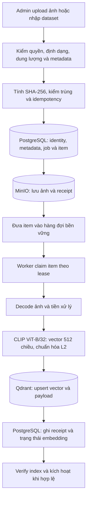
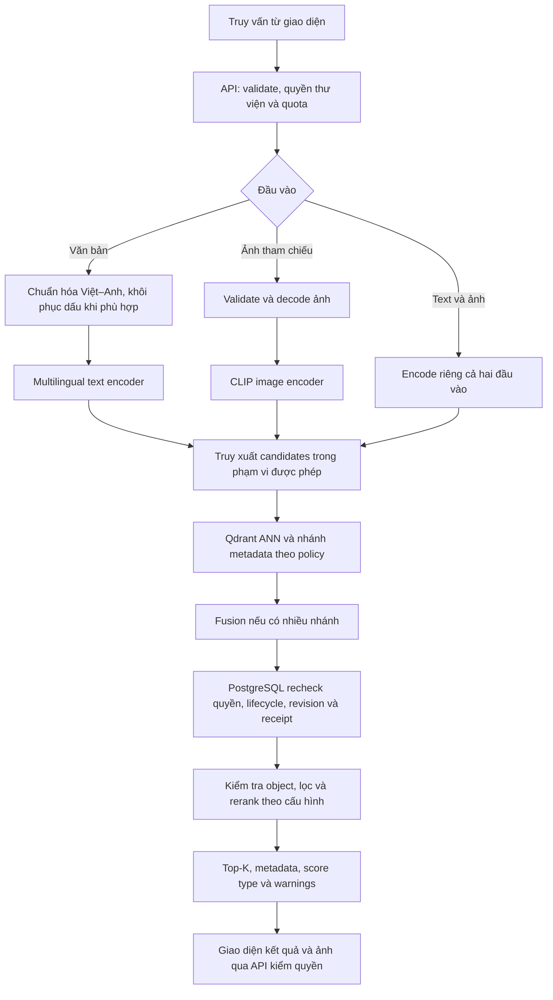

# Synlens — Tìm kiếm ảnh bằng AI

Synlens là ứng dụng web tìm kiếm ảnh bằng văn bản, ảnh tham chiếu hoặc kết hợp cả hai. Hệ thống sử dụng CLIP để mã hóa ảnh, text encoder đa ngôn ngữ cho truy vấn Việt–Anh và Qdrant để tìm kiếm vector. PostgreSQL lưu metadata, tài khoản và tác vụ; MinIO lưu ảnh; giao diện được xây dựng bằng React và TypeScript.

## Tính năng chính

- Tìm kiếm bằng văn bản tiếng Việt, tiếng Anh, ảnh tham chiếu và truy vấn kết hợp.
- Hỗ trợ truy vấn tiếng Việt không dấu, tìm theo metadata và lọc kết quả.
- Khách tìm bằng văn bản trong các thư viện được Admin công khai.
- Đăng ký, đăng nhập, phân quyền Admin/User và cấp quyền theo thư viện.
- Quản trị thư viện, hình ảnh, tài khoản và tác vụ lập chỉ mục.
- RAG và Agent tùy chọn, cần cấu hình model/provider và dữ liệu phù hợp.

Xem [hướng dẫn giao diện](docs/features/USER_INTERFACE.md), [tìm kiếm Việt–Anh](docs/features/BILINGUAL_SEARCH.md) và [tài khoản, phân quyền](docs/operations/ACCOUNTS.md).

## Pipeline xử lý của hệ thống

Synlens có hai luồng chính: **nhập ảnh và lập chỉ mục** trước khi phục vụ, sau đó **truy xuất ảnh theo truy vấn**. API và worker dùng chung codebase FastAPI nhưng chạy thành các process riêng. PostgreSQL quản lý metadata, quyền và jobs; MinIO giữ ảnh private; Qdrant giữ vector phục vụ tìm kiếm.

### 1. Nhập ảnh và lập chỉ mục



1. Admin chọn thư viện và nhập ảnh có metadata, nguồn và quyền sử dụng. Hệ thống validate đầu vào, hash nội dung và kiểm tra yêu cầu gửi lặp.
2. API ghi identity/job và lưu input bền vững trước khi đưa item vào trạng thái chờ xử lý. Nhận được job ID chưa có nghĩa ảnh đã lập chỉ mục xong.
3. Worker nhận item bằng lease, đọc ảnh, decode và tạo embedding bằng image encoder CLIP. Vector được chuẩn hóa L2 rồi ghi vào collection Qdrant tương ứng với index.
4. Receipt trong PostgreSQL liên kết ảnh, index, manifest và metadata revision. Chỉ ảnh đủ điều kiện mới được dùng trong tìm kiếm; lỗi được ghi theo từng item và retry có giới hạn.
5. Với index mới, thực hiện verify trước khi activate. Metadata thay đổi cần cập nhật revision/payload; ảnh ẩn bị chặn theo chính sách đọc.

Không có transaction chung cho cả ba kho dữ liệu. Jobs, idempotency, receipts và reconciliation giúp phát hiện/phục hồi các bước ghi dở dang. Xem [quy trình lập chỉ mục](docs/features/IMAGE_INDEXING.md) và [thiết kế nhất quán, phục hồi](docs/architecture/SAD.md#6-ingestion-jobs-và-nhất-quán-liên-kho).

### 2. Tìm kiếm và trả kết quả



| Chế độ | Cách xử lý |
| --- | --- |
| Văn bản | Text encoder đa ngôn ngữ đưa truy vấn Việt–Anh vào không gian CLIP tương thích; nhánh metadata hỗ trợ tìm tên/caption theo policy. |
| Ảnh | CLIP mã hóa ảnh upload; với image ID có sẵn, hệ thống kiểm quyền và vector receipt trước khi dùng vector tham chiếu. |
| Text + ảnh | Truy xuất theo hai đầu vào, hợp candidates bằng RRF, weighted RRF hoặc weighted score theo cấu hình. |
| Nhiều điều kiện | Phân tích AND/OR và required/optional trong giới hạn; evidence phân biệt đạt, không đạt và chưa xác minh. |
| Rerank | Tùy chọn trên tập candidates có giới hạn, có timeout và chính sách xử lý lỗi. |

Qdrant lọc trước theo phạm vi thư viện; PostgreSQL kiểm tra lại quyền và trạng thái trước khi xuất kết quả. API kiểm tra object khi chọn kết quả và kiểm quyền khi phục vụ media. Điểm cosine/fusion/reranker thể hiện thứ hạng, không phải xác suất ảnh đúng yêu cầu. Kết quả có thể ít hơn K sau khi lọc.

Ảnh upload để tìm kiếm **không tự thêm vào corpus**. Fast Search dùng model local và không cần LLM. Khi thiếu model/index hoặc dịch vụ phụ thuộc, hệ thống báo chưa sẵn sàng thay vì giả thành kết quả rỗng.

### 3. RAG và Agent tùy chọn

- **RAG:** ảnh/metadata đã được cấp quyền → thu thập evidence → dựng context có giới hạn → provider sinh giải thích → kiểm citation → trả giải thích hoặc thông báo thiếu bằng chứng.
- **Agent:** truy vấn quan hệ → planner → kiểm plan và budget → gọi tools được cho phép → tổng hợp evidence → kết quả hoặc fallback có lý do. Mặc định tối đa 3 hops, 6 tool calls và 1 replan.
- **Giọng nói:** audio → Gemini speech-to-text → transcript → luồng tìm kiếm văn bản. Chức năng này cần cấu hình provider và gửi audio ra ngoài; text/image search cơ bản chạy local.

RAG và Agent mặc định tắt. Evidence gửi provider phải tuân quyền thư viện; provider lỗi không làm core search bắt buộc mất khả năng trả ảnh. Xem [SAD](docs/architecture/SAD.md), [RAG](docs/features/RAG_ARCHITECTURE.md) và [Agent](docs/features/AGENT_ARCHITECTURE.md).

## Yêu cầu

Cách chạy khuyến nghị là Docker Compose trên Linux:

- Docker Engine đang hoạt động, Docker Compose và quyền truy cập Docker.
- Python 3.11–3.13 để chạy các script khởi tạo và quản trị.
- Kết nối mạng khi build image hoặc tải model lần đầu.

Nếu chạy backend/frontend trực tiếp trên máy, cần thêm Node.js 22 (từ 22.12, phiên bản dự án ghi trong `.nvmrc`), npm và uv. Xem [hướng dẫn cài đặt chi tiết](docs/operations/SETUP.md).

## Chạy nhanh với Docker

Thực hiện các lệnh từ thư mục gốc repository.

### Cài mới

```bash
python3 scripts/init_env.py
docker compose up -d --build --wait --wait-timeout 180 backend frontend
```

Script khởi tạo sinh `.env` với credentials riêng. Nếu `.env` đã tồn tại, script dừng và giữ nguyên file; bỏ qua bước khởi tạo khi chạy lại môi trường đã có.

Tạo tài khoản Admin ban đầu sau khi backend khởi động:

```bash
python3 scripts/administration/accounts.py bootstrap --env-file .env --output .cache/auth/admin-login.json
```

Mở `.cache/auth/admin-login.json` trên máy để lấy thông tin đăng nhập. Nếu đã có Admin hoạt động, bootstrap không đổi mật khẩu tài khoản đó. Xem [hướng dẫn tài khoản](docs/operations/ACCOUNTS.md) để quản lý người dùng và quyền thư viện.

### Chạy lại môi trường đã có

```bash
docker compose up -d --wait --wait-timeout 180 backend frontend
```

Thêm `--build` nếu thay đổi dependency hoặc Dockerfile. Compose tự khởi động PostgreSQL, Qdrant và MinIO mà backend phụ thuộc.

| Địa chỉ | Chức năng |
| --- | --- |
| http://localhost:5173 | Giao diện web |
| http://localhost:5173/login | Đăng nhập hoặc đăng ký |
| http://localhost:8000/docs | Tài liệu API/OpenAPI |
| http://localhost:8000/api/v1/health/live | Kiểm tra process backend |

### Chuẩn bị model và dữ liệu

Bản cài mới **chưa có model hoặc dữ liệu ảnh**. `SEARCH_ENABLED`, `RAG_ENABLED` và `AGENT_ENABLED` mặc định là `false`; khởi động thành công chưa có nghĩa là tìm kiếm đã sẵn sàng.

Để bật tìm kiếm, chuẩn bị model, nhập ảnh, lập chỉ mục và kích hoạt index theo các hướng dẫn:

1. [Model và cache](docs/operations/MODEL_MANAGEMENT.md), [text encoder Việt–Anh](docs/features/BILINGUAL_SEARCH.md).
2. [Nhập dataset](docs/operations/DATASET_IMPORT_GUIDE.md) và [quy trình lập chỉ mục](docs/features/IMAGE_INDEXING.md).
3. [Cấu hình hệ thống](docs/operations/CONFIGURATION_REFERENCE.md) và [kích hoạt tìm kiếm](docs/features/SEMANTIC_SEARCH.md).

Khi cần worker xử lý tác vụ nhập ảnh và lập chỉ mục:

```bash
docker compose --profile indexing up -d --build indexing-worker
```

Ảnh và model trên máy phát triển không được đóng gói cùng repository. Khách chỉ thấy dữ liệu của thư viện được Admin bật công khai; quyền chia sẻ cho thành viên được cấu hình riêng.

### Xem trạng thái, log và dừng

```bash
docker compose ps
docker compose logs -f --tail=100 backend frontend
docker compose down
```

`docker compose down` giữ dữ liệu trong named volumes. Tránh thêm `-v` nếu cần giữ dữ liệu.

Nếu máy dùng Docker Snap và phiên shell chưa nhận nhóm `docker`, có thể chạy lệnh Docker qua:

```bash
sg docker -c 'docker compose up -d --wait --wait-timeout 180 backend frontend'
```

Với helper tài khoản, dùng `ACCOUNTS_USE_SG=1` trước lệnh khi cần. [Đăng nhập nhanh Admin/User](docs/operations/QUICK_LOGIN.md) là tùy chọn dành cho development, mặc định tắt.

## Triển khai production-like

Quy trình dưới đây tạo môi trường riêng với frontend static, cấu hình `.env.deploy` và cổng mặc định `8080`:

```bash
python3 scripts/deploy.py init
python3 scripts/deploy.py validate
python3 scripts/deploy.py build
python3 scripts/deploy.py up
python3 scripts/deploy.py check
```

Mở http://127.0.0.1:8080. Môi trường này cũng cần chuẩn bị model, dữ liệu và tài khoản theo [hướng dẫn triển khai](docs/operations/DEPLOYMENT_GUIDE.md). Các cấu hình riêng của máy nghiệm thu được mô tả tại [danh mục môi trường](config/environments/README.md).

Triển khai public cần cấu hình domain, HTTPS và bảo mật tại môi trường thực tế; xem [bảo mật triển khai](docs/operations/SECURITY_DEPLOYMENT.md) và [backup/restore](docs/operations/BACKUP_AND_RECOVERY.md).

## Kiểm thử

QA sử dụng `.env.qa` và namespace riêng:

```bash
python3 scripts/qa.py up
python3 scripts/qa.py fast
python3 scripts/qa.py services
python3 scripts/qa.py frontend
python3 scripts/qa.py down
```

Trên máy cần chạy Docker qua nhóm `docker`, thêm `QA_USE_SG=1` trước mỗi lệnh QA. Kiểm thử sử dụng model thật cần cache đã chuẩn bị. Xem [kiểm thử và kiểm chứng](docs/operations/TESTING_AND_VERIFICATION.md) để chạy browser tests, kiểm tra mã nguồn và các bộ kiểm thử khác.

## Pipeline CI trên GitHub Actions

Workflow [quality.yml](.github/workflows/quality.yml) chạy khi mở/cập nhật pull request, push vào `main`/`master`, hoặc chạy thủ công bằng `workflow_dispatch`. Các jobs chính chạy độc lập:

| Job | Các bước chính |
| --- | --- |
| `backend-fast` | Cài dependency theo lockfile → Ruff → compile Python → unit, security và reliability tests → lưu JUnit artifact. |
| `frontend-fast` | `npm ci` → typecheck → lint → unit tests → build → Playwright với mock API → lưu kết quả. |
| `services` | Khởi tạo QA riêng → integration services → browser QA → kiểm quyền qua browser → fault tests → dừng QA và lưu artifacts. |
| `production-deployment` | Khởi tạo `.env.ci` không kèm ML → validate/build/up → bootstrap Admin → verify deployment rỗng → browser smoke → down và lưu artifacts. |
| `optional-real-model` | Chỉ chạy thủ công khi bật input `real_model`: tải model đã pin → khởi động QA với model → chạy AI pipeline → cleanup và lưu artifacts. |

Các bước cleanup/upload artifacts dùng `if: always()` để vẫn chạy sau khi bước trước thất bại. Job deployment kiểm tra triển khai trong GitHub runner; workflow hiện **không tự publish lên máy chủ production**. Kiểm tra model thật không chạy mặc định trên mọi push.

## Cấu trúc repository

```text
backend/              FastAPI, services, CLI, migrations và tests
frontend/             React, TypeScript, Vite; browser suites ở tests/e2e/
infra/                Docker infrastructure và Nginx
config/environments/  Cấu hình các môi trường
scripts/              Công cụ khởi tạo, quản trị, triển khai và QA
datasets/             Hướng dẫn/catalogs; corpus ảnh lưu local, không commit
evaluation/           Cấu hình, dữ liệu và kết quả đánh giá
docs/                 Tài liệu kỹ thuật và báo cáo kiểm chứng
workers/              Entry point tương thích cho worker
```

Xem [cấu trúc chi tiết](docs/REPOSITORY_STRUCTURE.md), [danh mục scripts](scripts/README.md), [browser suites](frontend/tests/e2e/README.md) và [quy tắc dữ liệu](datasets/README.md).

## Tài liệu và trạng thái kiểm chứng

- [Mục lục tài liệu](docs/README.md).
- [PRD — yêu cầu sản phẩm](docs/architecture/PRD.md) và [SAD — thiết kế kiến trúc](docs/architecture/SAD.md); [thiết kế lịch sử](docs/architecture/archive/README.md).
- [Lộ trình 12 giai đoạn — Phase 01–12](docs/architecture/ROADMAP.md).
- [Kiến trúc hệ thống](docs/architecture/FINAL_SYSTEM_ARCHITECTURE.md), [API](docs/architecture/API_SPECIFICATION.md), [database](docs/architecture/DATABASE_DESIGN.md).
- [Vận hành](docs/operations/OPERATIONS_RUNBOOK.md), [workflow phát triển](docs/operations/DEVELOPMENT.md).
- [Báo cáo nghiệm thu Phase12](docs/bao_cao_nghiem_thu/FINAL_PROJECT_REPORT.md) và [bàn giao](docs/bao_cao_nghiem_thu/FINAL_HANDOVER.md).

Trạng thái bàn giao Phase12 là **READY_WITH_LIMITATIONS**: triển khai chức năng đã được kiểm chứng local; chất lượng tìm kiếm/RAG do người đánh giá, khả năng chịu tải đại diện và triển khai public vẫn còn các điều kiện chưa xác nhận. Báo cáo nghiệm thu là bằng chứng tại thời điểm chạy, không thay thế kiểm chứng cho mọi thay đổi sau đó.

Không commit `.env`, credentials, provider keys, cache model hoặc backup dữ liệu. Các biến `VITE_*` chỉ dành cho cấu hình công khai của frontend.
