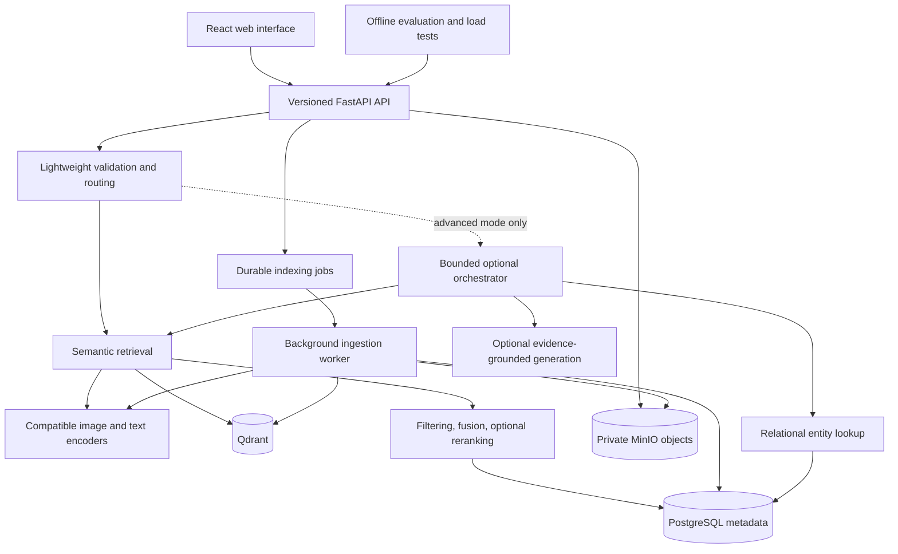

# AI Multimodal Image Search System — Master Specification

Cập nhật05/11/2026 — Prompt08: RAG metadata tùy chọn đã được triển khai trên SearchService hiện có, provider Gemini, typed evidence/citations và API/SSE/UI. [Nghiệm thu Phase08](PHASE08_TEST_REPORT.md) là báo cáo hiện hành; các trạng thái chưa triển khai RAG bên dưới là lịch sử. Agent/Prompt09 chưa triển khai.

Specification version: 1.1.0  
Established: 2026-11-03  
Phase: baseline Prompt 01, thiết kế chi tiết Prompt 02  
Status: đã có foundation, indexing, advanced retrieval, evaluation và RAG metadata tùy chọn Prompt08; quality/latency acceptance còn mở, Agent chưa triển khai. Quyết định mở tại [DECISIONS.md](DECISIONS.md).

Cập nhật Prompt06: đã có bounded query classifier/decomposer tiếng Việt/Anh, typed AND/OR AST, RRF/weighted-score fusion, independent text+image retrieval và optional constraint-aware reranking. Single-intent giữ fast path. Semantic evidence UNKNOWN, strict required semantic constraints trả409 khi thiếu verifier; quality chưa đo do thiếu human qrels. [ADVANCED_SEARCH_TEST_REPORT](ADVANCED_SEARCH_TEST_REPORT.md) là báo cáo hiện hành, [ADVANCED_SEARCH_API](ADVANCED_SEARCH_API.md) ghi contracts của phase trước.

## Cập nhật Prompt07 — 04/11/2026

Đã bổ sung công cụ gán nhãn offline, metrics/validation, immutable experiment tracking, latency/load, profiling, ablation, model comparison CLIP512/SigLIP2-768 và JSON/CSV/Markdown/charts. CLIP active generation1 được giữ; SigLIP dùng index riêng. Chưa có human labels nên semantic-quality/constraint-quality gate còn mở. [PHASE07_TEST_REPORT](PHASE07_TEST_REPORT.md) là báo cáo hiện hành, [EXPERIMENT_RESULTS](EXPERIMENT_RESULTS.md) ghi số liệu thật; các cập nhật phase trước bên dưới là lịch sử. Chưa triển khai Prompt08.

## Cập nhật implementation Prompt 05

Đã có CLIP paired text/image query encoder trên đúng manifest/index Prompt04, explicit active-pointer activation sau verify/model preload, Qdrant candidate retrieval, deterministic ranking/dedup, basic metadata filters/eligibility, private content URLs và React search UI thật. Không rebuild collection hoặc ghi query image vào corpus. Text/image latency được đo riêng bằng full ASGI request IDs; chưa có human-verified qrels nên actual retrieval quality chưa đo. Evidence/limits tại [SEARCH_TEST_REPORT](SEARCH_TEST_REPORT.md), contracts tại [SEARCH_API](SEARCH_API.md), architecture tại [SEMANTIC_SEARCH](SEMANTIC_SEARCH.md), phương pháp tại [SEARCH_PERFORMANCE](SEARCH_PERFORMANCE.md). Prompt06 chưa bắt đầu; không có fusion, multi-intent, reranking, RAG, Agent hoặc multi-hop.

## Snapshot implementation Prompt 04

Đã có image validation có giới hạn tài nguyên, original storage, exact dedup, upload/content/job APIs, PostgreSQL durable worker và CLIP batch embeddings thật, Qdrant version compatibility/upsert verification/reindex/repair. Fixture corpus gồm10 ảnh scikit-image có provenance/rights, CLIP revision pinned,512 chiều cosine/L2 được kiểm chứng runtime. Model cache/dataset tải explicit và ignored, không commit weights. Xem [IMAGE_INDEXING](IMAGE_INDEXING.md), [EMBEDDING_MODELS](EMBEDDING_MODELS.md), [VECTOR_INDEX_DESIGN](VECTOR_INDEX_DESIGN.md) và [INDEXING_TEST_REPORT](INDEXING_TEST_REPORT.md) cho commands/evidence/giới hạn. Prompt05 chưa bắt đầu; chưa có search API hoặc retrieval benchmark. Các trạng thái phase trước bên dưới là snapshot lịch sử.

## Snapshot implementation Prompt 03

Đã nghiệm thu FastAPI/React, settings/logging/errors/request middleware, live/infrastructure readiness, PG/Qdrant/MinIO adapters, migration sáu bảng và Compose năm services trên Docker thật. Unit/integration/browser tests, volume persistence và dependency outage/recovery đã qua; Git nhánh main đã được khởi tạo, chưa có commit. Không tải AI models, không tạo arbitrary-dimension collections hoặc trả search results giả. [PHASE03_REPORT](PHASE03_REPORT.md) ghi evidence và giới hạn hiện tại. Các mục trạng thái Prompt01/02 bên dưới là snapshot lịch sử; kiến trúc đầy đủ vẫn là target theo phase, không phải mọi module đã chạy. Prompt04 chưa bắt đầu.

## Bổ sung Prompt 02 — 2026-11-03

Giữ nguyên nội dung baseline Prompt 01 bên dưới để bảo toàn lịch sử. Đặc tả tiếng Việt mới gồm [PRD](PRD.md), [SAD](SAD.md), [SYSTEM_ARCHITECTURE](SYSTEM_ARCHITECTURE.md), [DATABASE_DESIGN](DATABASE_DESIGN.md), [API_SPECIFICATION](API_SPECIFICATION.md), [PERFORMANCE_DESIGN](PERFORMANCE_DESIGN.md) và [DESIGN_REVIEW](DESIGN_REVIEW.md). Chúng chi tiết hóa baseline; không giảm ưu tiên P0. `FR-001…023` là aliases zero-padding của `FR-01…23`, `NFR-001…012` tương ứng `NF-01…12`; FR-024 tách rõ compatible embedding generation.

Các lựa chọn local MVP: single-tenant, Bearer scopes cấu hình backend, PostgreSQL durable job queue, authenticated content proxy, query-image không tự index, agent synchronous JSON và off mặc định. Giới hạn/timeout là dev defaults cần kiểm chứng, không phải năng lực đã đo. Prompt 02 được người dùng yêu cầu riêng; Prompt 03 chưa được khởi động. Các câu về trạng thái Prompt 01 bên dưới là snapshot lịch sử, không phải tuyên bố phase hiện tại chưa bắt đầu.

## 1. Purpose and authority

Build a reproducible university graduation project for semantic image retrieval, with research evaluation and a production-oriented architecture. Users search using text, a reference image, or both. Semantic retrieval is the primary engine. RAG and agents are optional extensions whose failure must not disable ordinary search.

This document normalizes the supplied Master Project Specification. [REQUIREMENTS.md](REQUIREMENTS.md) defines traceable requirements and measurements; [ROADMAP.md](ROADMAP.md) defines the twelve phase gates; [ENGINEERING_STANDARDS.md](ENGINEERING_STANDARDS.md) defines implementation and verification rules; [DECISIONS.md](DECISIONS.md) distinguishes adopted principles, provisional defaults, and unresolved choices. These five documents form the Prompt 01 baseline. Changes to scope require updates to affected requirements, decisions, and phase gates together.

Prompt 01 creates documentation only. No application, infrastructure, model downloads, migrations, datasets, or benchmark execution are included. Prompt 02 requires a subsequent instruction.

## 2. Scope and priorities

| Priority | Included capability | Completion boundary |
| --- | --- | --- |
| P0 | Text-to-image and image-to-image retrieval; ingestion; embeddings; vector search; configurable Top-K; metadata; APIs; usable web interface; quality and latency evaluation | Reliable, reproducible end-to-end core with real indexed images and measured results |
| P1 | Combined image/text retrieval; multi-intent processing; decomposition; metadata filters; reranking; constraint handling; hybrid retrieval when justified | Evaluated additions with documented tradeoffs against the P0 baseline |
| P2 | Evidence-grounded explanations; bounded agents; relational lookup; multi-hop retrieval | Independently enabled extensions with traces, budgets, and safe fallback |

P0 may be delivered through staged CLI/API/UI milestones. The complete P0 interface is due in Prompt 10 and reliability verification in Prompt 11. P1/P2 work must preserve the functioning P0 path and its regression evidence.

Out of initial scope: native mobile applications, custom model training, premature microservices, a graph database, unrestricted autonomous agents, arbitrary URL fetching, automatic caption generation as a prerequisite for retrieval, and claims of guaranteed semantic constraint satisfaction. Their introduction requires a documented need and an updated plan.

## 3. User behavior

| Input | Required behavior | Priority |
| --- | --- | --- |
| Text: “a red motorcycle on a street” | Encode text and retrieve semantically similar indexed images | P0 |
| Uploaded reference image | Validate/decode image, encode it, retrieve similar images | P0 |
| Reference image plus “with a red motorcycle” | Retrieve candidates for both modalities; fuse and optionally rerank; disclose fusion method | P1 |
| Text with several conditions, such as motorcycle, helmet, rain | Distinguish required/optional conditions; retrieve and assess constraints without automatically calling an agent | P1 |
| “Landmarks in the city where Hoan Kiem Lake is located” | Resolve the relation using evidence, then retrieve landmark images; record each step | P2 |

Empty or invalid input produces a structured validation error. A valid query with no eligible matches produces a successful empty result. A disabled advanced mode produces an explicit feature-unavailable response unless the caller has allowed a disclosed direct-search fallback.

## 4. Architecture

Use a modular monolith with explicit Python module boundaries. A background worker can run as a separate process from the same codebase. PostgreSQL, Qdrant, and MinIO are external persistence services; their presence does not imply separate business microservices.

### Fast search path

Request receipt → validation and lightweight processing → compatible query encoder → Qdrant candidate retrieval → optional eligible filtering/reranking → authoritative metadata hydration and deduplication → response completion.

Image-only requests use the image encoder. Text-only requests use the paired text encoder. Multi-intent text remains on this path unless relational reasoning is explicitly requested. Model loading occurs before readiness, never on every request. No LLM is required on this path.

### Advanced search path

Explicit advanced request → deterministic router → bounded planner/workflow → relational lookup and retrieval tools → evidence aggregation → optional generation → response with image IDs, citations, trace, and fallback status.

The orchestrator depends on retrieval interfaces; retrieval must not depend on orchestrator availability. Hop, tool-call, token, and wall-clock budgets are explicit configuration. Unknown relations must remain unresolved rather than be invented. Direct fallback cannot be represented as successfully resolved multi-hop reasoning.

### Module ownership and dependencies

| Module | Responsibility | Dependencies |
| --- | --- | --- |
| Web application | Inputs, preview, modes, filters, result grid, details, feedback | Versioned API only |
| API layer | Validation, authentication policy, deadlines, error envelopes, response serialization | Application services |
| Query processing/router | Input normalization, mode and intent selection, explicit constraints | Typed query contracts; optional planner for P2 |
| Embedding adapter | Model-specific processors, inference, normalization, model manifest | PyTorch, Transformers, pinned artifacts |
| Retrieval engine | Candidate selection, Top-K, compatibility checks, stable result assembly | Embedding adapter, vector adapter, metadata repository |
| Filtering/reranking | Structured filters, fusion, scoring, deduplication, constraint evidence | Candidate and metadata contracts; optional reranker |
| Ingestion worker | Validation, hashing, durable jobs, indexing, retries, repair | Embedding, storage, metadata, vector adapters |
| Metadata repository | Image records, provenance, lifecycle, job state, entity relationships | PostgreSQL via SQLAlchemy/Alembic |
| Vector adapter | Versioned collections, cosine search, payload filters, point upserts | Qdrant |
| Object storage adapter | Private originals and optional derived previews, authorized access | MinIO |
| RAG service | Explanations from supplied evidence, image-ID citations | Retrieved evidence; optional generation provider |
| Agent service | Bounded tools, relational reasoning, traces, explicit fallback | Retrieval, entity repository, optional RAG |
| Evaluation framework | Fixed manifests, relevance metrics, latency/load/resource reports | Query sets, judgments, API/client or retrieval harness |

Persistence adapters must be replaceable without embedding storage-specific calls in query or UI logic. Evaluation consumes public contracts or explicitly documented internal benchmark interfaces.

## 5. Technology baseline

| Area | Proposed stack | Rationale and decision boundary |
| --- | --- | --- |
| Host/runtime | Linux, Python 3.11+ | Matches the requested development environment; exact supported version pinned in Prompt 03 |
| API/data contracts | FastAPI, Pydantic | Typed validation and documented REST contracts |
| Metadata/migrations | PostgreSQL, SQLAlchemy, Alembic | Transactional records, constraints, migrations, initial relational entity lookup |
| Frontend | React, strict TypeScript, Vite, Tailwind CSS | Responsive browser interface with a reproducible build |
| Encoders | PyTorch, Hugging Face Transformers; CLIP baseline | Compatible image/text encoders behind a versioned adapter |
| Comparison model | SigLIP 2, checkpoint pending | Candidate for E2; suitability must be measured on target languages and images |
| Vector retrieval | Qdrant, cosine metric, HNSW where appropriate | Dedicated vector retrieval with filterable payloads and tunable approximate search |
| Image storage | MinIO | Private object storage with stable object keys |
| Worker | Same-codebase worker, PostgreSQL-backed durable job records proposed | Avoids an additional broker until workload demonstrates need |
| Optional orchestration | Lightweight workflow first; LangGraph if justified | Explicit budgets and testable tools without mandatory agent infrastructure |
| Packaging/verification | Docker, Compose, Git, pytest, Locust or equivalent | Reproducible services, automated verification, controlled load generation |

These are design selections, not assertions that packages are installed or mutually validated. Exact package versions, container digests, model revisions, licenses, and hardware compatibility must be pinned and checked in Prompt 03 or the relevant model phase. No model dimension or performance is assumed before checkpoint selection.

## 6. Retrieval and model invariants

1. A query and its searchable image vectors must use a compatible paired encoder and identical embedding-space manifest. Equal dimension alone does not establish compatibility.
2. Record model identifier, immutable revision, processor/tokenizer revision, dimension, normalization, precision, preprocessing, text truncation policy, and index version. Different checkpoints or preprocessing configurations require separate versioned indexes and controlled reindexing.
3. Use model-prescribed image resizing/cropping, channel conversion, normalization, tokenization, and text limits. Validate finite, nonzero vectors and L2-normalize for the cosine baseline. Do not silently truncate queries without a documented policy and response notice.
4. Qdrant collection configuration must match the manifest. Its cosine implementation normalizes vectors; application-side validation still provides a consistent adapter contract. See [Qdrant collection documentation](https://qdrant.tech/documentation/manage-data/collections/).
5. Record candidate count, final K, filter predicates, index/HNSW parameters, and optional reranker/fusion version. Retrieve candidates with C ≥ K; exact defaults and upper bounds are decided through capacity review and benchmarks. Fewer than K eligible images is valid.
6. Apply supported structured metadata filters during retrieval where possible, then verify eligibility against authoritative metadata. Never silently relax a mandatory filter to fill K.
7. Expose score type and ranking method. Cosine similarity and fused/reranker scores are ordering signals, not calibrated relevance probabilities. Use stable image-ID tie breaking.
8. Evaluate late fusion, normalized score fusion, and rank fusion for P1. Do not assume image/text embedding addition implements compositional edits. Reciprocal rank fusion is a provisional first candidate; weights and method must be validated rather than selected on held-out test results.
9. Semantic constraints require evidence. Caption/tag matches are not proof of all visual properties; preserve satisfied, unsatisfied, and unknown assessments. Hard metadata predicates and semantic preferences have different guarantees.

CLIP processors and paired encoders are documented in [Transformers CLIP documentation](https://huggingface.co/docs/transformers/model_doc/clip). SigLIP 2 preprocessing is checkpoint dependent; use its own processor rather than CLIP settings. See [Transformers SigLIP 2 documentation](https://huggingface.co/docs/transformers/model_doc/siglip2).

## 7. Ingestion, consistency, and lifecycle

The indexing pipeline is durable background work: accept dataset/upload input → validate content and resource limits → hash original bytes → resolve duplicate identity → preprocess → embed → extract provided metadata → optionally caption → store private object → persist metadata and vector state → verify required artifacts → publish searchable status. Hashing and image identity must be recorded before external writes; metadata may exist in a non-searchable pending state during processing.

Use one stable image UUID across PostgreSQL, object-key ownership, and Qdrant point identity. Content SHA-256 plus a database uniqueness rule prevents duplicate byte-identical assets, including concurrent uploads. A model/index-version uniqueness rule prevents repeated embedding records. Near-duplicate detection is a separate optional capability; byte hashes do not find resized or recompressed copies.

There is no assumed atomic transaction across PostgreSQL, Qdrant, and MinIO. A durable state machine, idempotent upserts, bounded retries, worker claims/leases, and reconciliation must recover partial writes and crashed workers. Only assets verified ready in the active index are eligible for results. Search must exclude stale or non-ready records, even if stale points exist. Missing objects or metadata trigger repair and observability, not invented results.

Jobs track per-item state, attempts, error code, active model/index version, and aggregate progress. Failed items remain inspectable and retryable. New index versions are built and verified separately before activation, retaining rollback capability and documenting cleanup. Exact schema, transitions, and compensation rules belong to Prompt 02/04.

## 8. API and interface boundary

All public contracts use `/api/v1`. The following behavior is required; detailed fields, media types, status codes, auth matrix, pagination, and OpenAPI design are Prompt 02 deliverables.

| Endpoint | Intended contract |
| --- | --- |
| `POST /api/v1/search` | Text or reference-image core search, explicit mode and K; image transport finalized in Prompt 02 |
| `POST /api/v1/search/multimodal` | Combined text/image search, fusion settings and constraints, gated P1 |
| `POST /api/v1/search/agent` | Explicit bounded advanced request, trace and evidence, gated P2 |
| `POST /api/v1/images` | Validate image submission and return durable identity/job reference; asynchronous indexing status |
| `GET /api/v1/images/{id}` | Authorized metadata, lifecycle, and image-access information |
| `POST /api/v1/index/jobs` | Authorized batch/reindex request against approved inputs; no arbitrary server path access |
| `GET /api/v1/index/jobs/{id}` | Job/item progress, failures, retry state; paginate item lists |
| `GET /api/v1/health` | Liveness/readiness distinction and required-dependency status without secret disclosure |

Search results include stable image ID, authorized image/preview access, metadata, rank, score with type, active model/index version, executed mode, and warnings/fallback information where applicable. Search response timing fields must distinguish time observed before serialization from the final server-response metric. Error envelopes include machine-readable code, safe message, request ID, retryability, and safe field details.

The responsive UI includes text input, image upload/preview, search mode, configurable K, filters, loading and empty/error states, grid, image details and metadata. AI explanations are optional and visibly identify their supporting images. The UI must not advertise unimplemented modes as usable.

## 9. Quality, performance, and security

The authoritative measurement protocol and formulas are in [REQUIREMENTS.md](REQUIREMENTS.md). Objectives: core P90 ≤ 300 ms; proposed P95 ≤ 500 ms; optional Agent/RAG TTLast ≤ 3 seconds. These are engineering objectives, not measured or guaranteed results. No dataset scale, QPS, concurrency, hardware, or accuracy threshold is established yet.

Evaluate Recall@1/5/10, Precision@10, MRR, nDCG@10, P50/P90/P95 latency, throughput, error rate, and resource consumption. Separate query groups and E1–E4 configurations. Record constraint satisfaction and multi-hop task success where applicable. Publish actual failures to meet targets.

Secure upload handling includes byte/pixel/resource limits, decoded content validation, explicit format allowlist, safe generated object names, private buckets, least-privilege credentials, restricted CORS, API validation, bounded execution, and path protection. Proposed initial formats are JPEG/PNG/WebP; exact limits and animated/multiframe policy remain open. Untrusted filenames, image metadata, captions, and agent evidence are data, never executable instructions.

For implementation phases, automated tests must cover meaningful behavior, partial failures, compatibility, and integration. Documentation-only phases use consistency and link checks. No numerical benchmark claim may be substituted for missing measurements.

## 10. Phase readiness and current limits

Prompt 01 is complete when all five documents exist, preserve the supplied priorities, define measurable requirements and all twelve gates, and explicitly record unknowns. Prompt 02 can proceed using this baseline to produce PRD, SAD, detailed contracts, and logical database design. Dataset/hardware decisions may remain open during early design, but must be settled before claims about capacity, language quality, or benchmark success.

Historical Prompt01 snapshot: documentation baseline only. No application functionality, deployed services, downloaded models, relevance labels, performance results, or verified dependency matrix exists. The supplied workspace has no valid Git repository; documents can be versioned after a writable project repository is provided or established in a later authorized phase.
