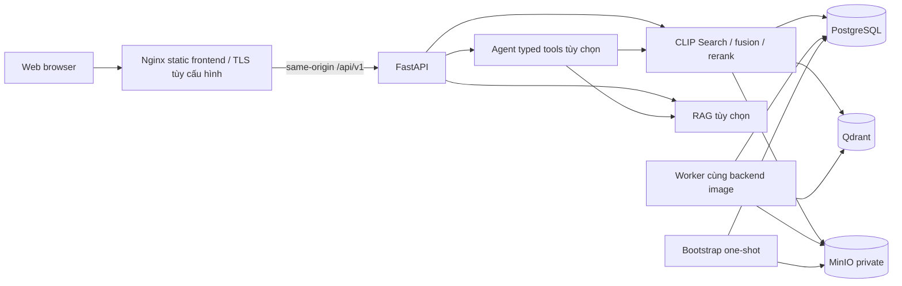
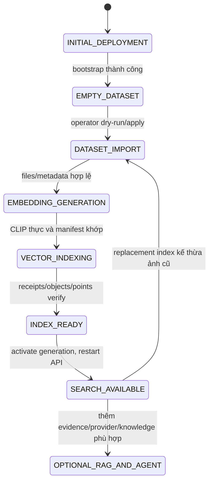

# Kiến trúc thực tế bàn giao

Cập nhật tài khoản/UI 08/11/2026: xem [thiết kế quyền](../architecture/ACCESS_CONTROL.md) và [hướng dẫn đăng nhập](../operations/ACCOUNTS.md). Các hướng dẫn dùng data token trước đây chỉ áp dụng khi bật legacy; mặc định mới dùng session tài khoản.

Modular monolith giữ nguyên. Search fast không gọi LLM. RAG post-retrieval và Agent relational workflow có endpoint/flags/deadlines riêng. PostgreSQL giữ identity/metadata/job/lease/active pointer và knowledge; Qdrant giữ vector/payload dẫn xuất theo manifest; MinIO giữ original/dataset manifest. Thumbnail hiện được tạo theo yêu cầu từ original; schema có role hỗ trợ lưu thumbnail khi pipeline bổ sung. Không giả định distributed transaction.

## Services và storage

Compose development cũ giữ source mounts/Vite. Compose production độc lập không mount app source. API/worker dùng cùng runtime image, lệnh startup khác; worker là process riêng. Bootstrap chờ service health, guarded migration và bucket private trước API/worker. Frontend chỉ publish ingress; data services ở network internal, named volumes theo project. App network có egress cho provider khi được cấu hình.

Persistent volumes: postgres_data, qdrant_data, minio_data và evaluation_artifacts. Model/data input là bind mounts read-only ở runtime, tách khỏi image. Worker heartbeat ở tmpfs, không phải durable job store; PostgreSQL leases/attempts mới là nguồn recovery.

## Vòng đời dữ liệu

Không dataset hoặc model không làm frontend biến mất. Empty dataset khác no-match và dependency unavailable. Optional features không tự bật khi có ảnh. New index re-embed các ảnh sẵn sàng của active index trước và ảnh mới; giữ old collections/data, chuyển pointer sau verification. Captions không tự thành knowledge relations; strict semantic evidence chưa có verifier không được gọi VERIFIED_MATCH.

## Chưa triển khai hoặc chưa nghiệm thu

Production adapter được kiểm chứng là CLIP CPU; SigLIP thuộc evaluation, GPU chưa nghiệm thu. Không native mobile apps, crawler ngầm, unrestricted Agent shell, multi-tenant account system, distributed cluster hoặc public hosting được provision. Signed URLs không dùng: private authenticated media proxy là kiến trúc đã chọn. Chi tiết contracts và sequence diagrams trước vẫn tại [SYSTEM_ARCHITECTURE](SYSTEM_ARCHITECTURE.md), [SAD](SAD.md) và docs/diagrams; tài liệu này phản ánh packaging hiện hành.
