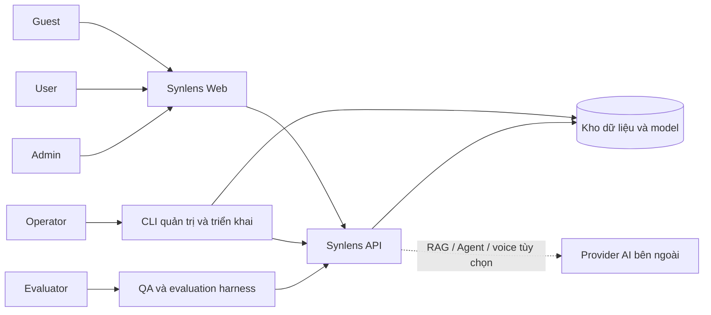
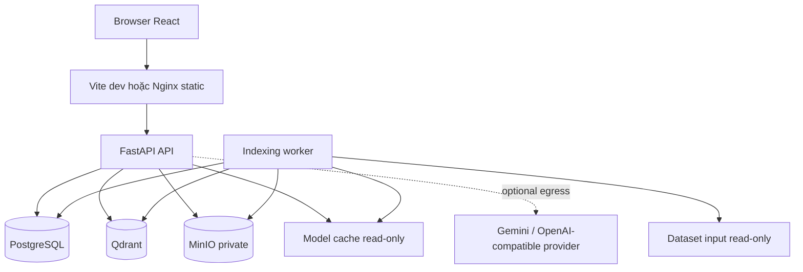
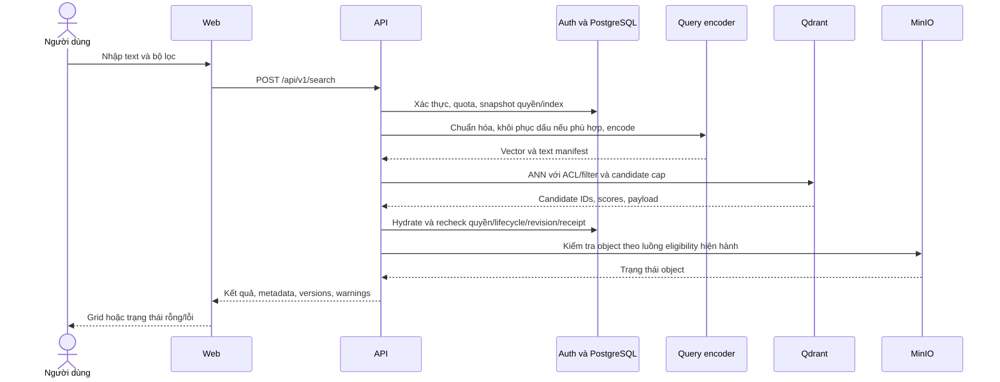
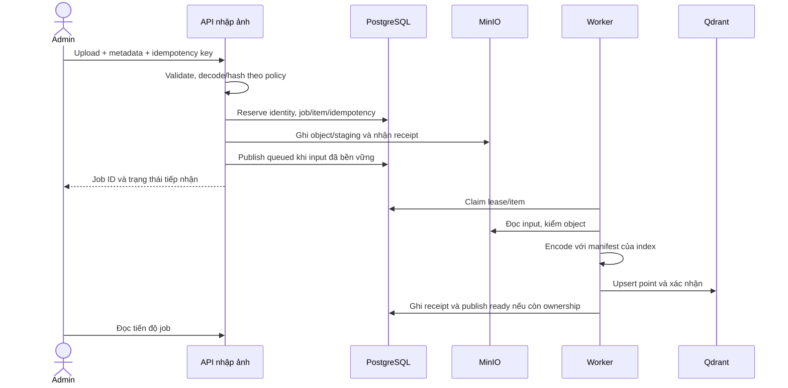
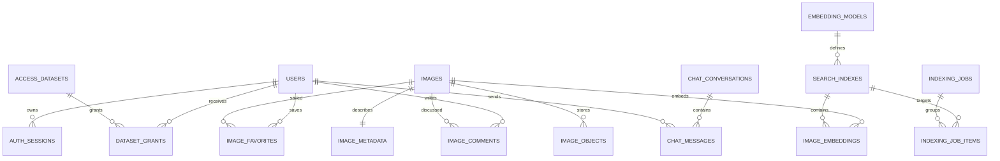
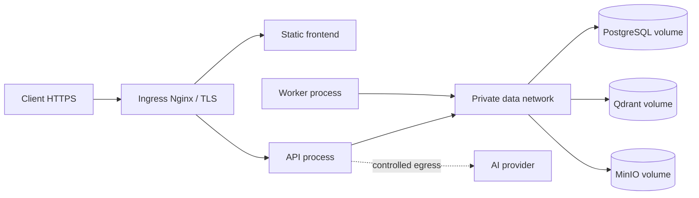

# SAD — Thiết kế kiến trúc phần mềm Synlens

| Thuộc tính | Giá trị |
| --- | --- |
| Phiên bản | 2.0 — bản rà soát thiết kế |
| Ngày cập nhật | 23/11/2026 |
| Đầu vào | [PRD 2.0](PRD.md), source backend/frontend và Compose tại workspace |
| Trạng thái | Thiết kế hiện hành và hướng củng cố; chưa phải chứng nhận chạy production |
| Phạm vi triển khai | Modular monolith; API và worker là process riêng; một hệ thống với ACL theo thư viện |
| Bản trước | [SAD baseline](SAD_BASELINE_20261103.md) |

## 1. Mục đích, phạm vi và nguyên tắc

Tài liệu nối các yêu cầu sản phẩm với thành phần, dữ liệu, luồng thực thi, ranh giới tin cậy, xử lý lỗi và vận hành. Các mô tả “hiện hành” được đối chiếu với source, không suy ra rằng deployment nghiệm thu đã cập nhật cùng phiên bản. Các đề xuất mở rộng được ghi riêng, không xem là đã triển khai.

Nguyên tắc kiến trúc:

1. Fast Search không phụ thuộc vào LLM/provider. RAG, Agent và voice có capability, quota và failure policy riêng.
2. PostgreSQL quyết định identity, quyền, lifecycle và metadata revision; Qdrant tăng tốc retrieval, không quyết định quyền cuối cùng.
3. Object storage private; browser nhận media qua API kiểm quyền.
4. Model/index phải tương thích theo manifest, revision, preprocessing và vector receipts; số chiều giống nhau chưa đủ.
5. Mọi tài nguyên tốn chi phí có giới hạn: upload, candidates, queue, inference, retry và reasoning.
6. Không giả định transaction phân tán giữa PostgreSQL, MinIO và Qdrant; dùng durable jobs, idempotency, receipts và reconciliation.
7. Chỉ công bố chất lượng/capacity khi có dữ liệu và báo cáo cùng phiên bản.

## 2. Bối cảnh và các tác nhân



Browser là client không tin cậy. Metadata/caption, evidence, file ảnh/audio và mọi trường từ client đều là dữ liệu không tin cậy. Host CLI là ngữ cảnh vận hành có đặc quyền; không được chuyển trực tiếp thành public HTTP endpoint bỏ qua auth.

Hệ thống hiện không cung cấp tenant isolation cấp tổ chức. Admin quản lý nội dung toàn hệ thống; chat riêng vẫn kiểm membership độc lập. Việc mở rộng thành SaaS nhiều tổ chức cần thay đổi ownership, dedup scope, truy vấn quyền, object key và audit.

## 3. Các quyết định kiến trúc

| ID | Quyết định | Lý do | Đánh đổi và điều kiện xem xét lại |
| --- | --- | --- | --- |
| AD-01 | Modular monolith, API/worker tách process | Dễ phát triển, test và vận hành, tái sử dụng nghiệp vụ/model | CPU/RAM cạnh tranh; chỉ tách inference service khi profiling chứng minh cần |
| AD-02 | PostgreSQL durable jobs | Có transaction, constraints và progress; không cần broker bổ sung | Polling/locks tăng tải; xem lại khi queue age/DB contention vượt gate được chốt |
| AD-03 | PostgreSQL + Qdrant + MinIO | Mỗi kho phục vụ metadata/ANN/blob phù hợp | Cần receipts, retry, reconcile và backup phối hợp |
| AD-04 | Model core local, provider optional | Core độc lập mạng/provider và kiểm soát data egress | CPU inference có độ trễ, cache/model cần chuẩn bị rõ ràng |
| AD-05 | ACL hai lớp retrieval + hydration | Giảm ứng viên sai quyền và chặn payload stale | Phải kiểm đồng bộ mọi endpoint phụ, không chỉ search chính |
| AD-06 | Session cookie + CSRF cho web | Token không cần nằm trong JS/localStorage | Cần Origin/cookie/HTTPS đúng; legacy bearer chỉ tương thích khi bật rõ |
| AD-07 | Index collection và active generation có version | Không query space sai khi thay model/index | Online activation nhiều replicas chưa được hỗ trợ đầy đủ |
| AD-08 | Fusion theo rank/score có version, rerank tùy chọn | Minh bạch chi phí và tái lập thí nghiệm | Chất lượng phải đo, không mặc định fusion tốt hơn mọi truy vấn |
| AD-09 | Chat attachment độc lập corpus ảnh | Tránh thông tin riêng lọt vào search/evidence | Cần membership và cleanup/retention riêng |

Các quyết định lịch sử xem [DECISIONS](DECISIONS.md). ID AD trong tài liệu này dùng cục bộ, không thay số của ADR lịch sử.

## 4. Kiến trúc container và module



API và worker dùng cùng codebase backend, có vòng đời và giới hạn tài nguyên riêng. Không có Redis, Kafka, graph database hoặc inference microservice bắt buộc trong kiến trúc hiện hành.

### 4.1 Trách nhiệm và vị trí source

| Thành phần | Trách nhiệm | Vị trí |
| --- | --- | --- |
| HTTP routes | Parse/validate/auth, gọi nghiệp vụ, response và status | `backend/app/api/v1/` |
| Core | Settings, auth/principal, ACL, middleware, lifecycle adapters | `backend/app/core/` |
| DTO | Contracts và invariant đầu vào/đầu ra | `backend/app/schemas/` |
| Persistence | SQLAlchemy models/session, metadata/knowledge queries | `backend/app/db/`, `backend/app/repositories/` |
| External adapters | Kết nối Qdrant và MinIO | `backend/app/integrations/` |
| Embeddings | CLIP image, multilingual text, accent restore, manifests/hashes | `backend/app/services/embeddings/` |
| Search | Runtime, registry, retrieve, fusion, rerank, metadata matching, discovery/suggestions | `backend/app/services/search/` |
| Query | Classification, parsing, decomposition và constraints | `backend/app/services/query/` |
| Ingestion/indexing | Validate/decode/storage, submission/jobs, worker, verify/activation | `backend/app/services/ingestion/`, `backend/app/services/indexing/` |
| Account/catalog | Tài khoản, phạm vi thư viện và workspace | `services/accounts.py`, `services/dataset_access.py`, `services/catalog.py`, `services/workspace.py` |
| Cá nhân | Profile/favorite và chat; comment qua routes/models | `services/profiles.py`, `services/chat.py`, `api/v1/comments.py` |
| AI tùy chọn | Evidence/context/provider/citations, planner/tools/budgets | `backend/app/services/rag/`, `backend/app/services/agent/` |
| Frontend | Feature modules, API typed, dialog, auth và workspace state | `frontend/src/features/`, `frontend/src/services/api/` |
| Vận hành/đánh giá | CLI, migrations, QA, deploy và benchmark | `backend/app/cli/`, `backend/alembic/`, `scripts/`, `evaluation/` |

Quy tắc bảo trì: route giữ logic HTTP; invariant quan trọng phải được áp ở service/repository và database phù hợp, không chỉ ở UI. Không truyền ORM object hoặc credentials thành public response tùy ý. Không dùng in-process background task làm queue bền vững.

### 4.2 Frontend state

Auth state xác định account/capabilities; search state chứa input, mode, filters, kết quả và request đang hoạt động. Khi đổi account/role/phạm vi, phải bỏ workspace cũ và tải lại. Request tìm kiếm mới hủy hoặc vô hiệu response cũ bằng request identity; tránh kết quả chậm ghi đè truy vấn mới.

UI tách fast search, Agent và explanation vì vòng đời/deadline khác nhau. API client xử lý cookie/CSRF, decode response và safe error. Blob URL preview phải revoke khi thay ảnh/đóng view. Cá nhân hóa không được trở thành nguồn cache kết quả bỏ qua ACL.

## 5. Thiết kế tìm kiếm online

### 5.1 Luồng text search



1. Validate input/mode/DTO, xác thực Guest hoặc account, áp Origin/CSRF/quota theo ngữ cảnh.
2. Snapshot runtime/index registry và phạm vi thư viện cho request; không đổi collection giữa các bước.
3. Chuẩn hóa Unicode/whitespace; query encoder đa ngôn ngữ xử lý text. Khôi phục dấu là bước có giới hạn và có thể sai, không phải dịch vụ dịch ngoài.
4. Metadata matching sử dụng title/caption và dữ liệu có quyền; kết hợp semantic khi policy áp dụng. Phải giữ quyền/hard filters xuyên suốt cả nhánh metadata.
5. ANN trả candidates trong giới hạn; PG hydrate và kiểm lại eligibility. Source hiện có `object_available` dùng `stat_object` khi chọn kết quả; không được dự toán latency như thể mọi request chỉ có PG/Qdrant.
6. Dedup/rank, optional fusion/rerank, trả tối đa K. Điểm xếp hạng có `score_type` và `ranking_version`.

### 5.2 Image, multimodal và nhiều điều kiện

Image upload được validate/decode trong giới hạn; encode bằng CLIP image. Với image ID, kiểm quyền và trạng thái indexed, đối chiếu stored vector receipt trước khi dùng vector tham chiếu. `exclude_self` loại ảnh tham chiếu theo policy.

Text+image encode riêng và hợp candidate lists. Các phương pháp source hỗ trợ: `rrf`, `weighted_rrf`, `weighted_score`. Với weighted RRF, đóng góp của nhánh m cho ảnh i có dạng `w_m / (k + rank_m(i))`; không so trực tiếp cosine và điểm lexical chưa chuẩn hóa. Các weight phải hữu hạn và tổng weight dương.

Multi-intent có giới hạn clauses/branches. Các điều kiện metadata là hard predicate; similarity thị giác không tự chứng minh điều kiện. Assessment dùng satisfied/violated/unknown; strict verification không nhận unknown như đạt. Rerank lightweight hoạt động trên candidate cap và timeout riêng; không mặc định là cross-encoder/VLM có khả năng xác minh thị giác.

### 5.3 Manifest và model

| Artifact | Thiết kế hiện hành |
| --- | --- |
| Image embedding | CLIP ViT-B/32, 512 chiều, float32, L2, cosine theo pipeline hiện hành |
| Text embedding | `sentence-transformers/clip-ViT-B-32-multilingual-v1`, projection vào không gian CLIP tương ứng |
| Khôi phục dấu | Claví local trước text encoding theo điều kiện trong query encoder |
| Compatibility | Pin model revision, processor/preprocessing, code/library/artifact hashes; kiểm receipt, không chỉ kiểm dimension |
| Cache | Model chuẩn bị qua CLI; API/worker mount read-only, không tự tải khi phục vụ request |
| Query cache | Cache vector RAM có giới hạn theo encoder; không cache quyền hoặc kết quả tìm kiếm như sự thật lâu dài |

Revision/hash cụ thể lấy từ manifest của release và [hướng dẫn song ngữ](../features/BILINGUAL_SEARCH.md); không thay weights bằng file cùng tên. Đổi image space cần collection mới và re-embed. Thay text encoder chỉ tái sử dụng image index khi đã xác minh tương thích space.

## 6. Ingestion, jobs và nhất quán liên kho

### 6.1 Quy trình



Đây là thứ tự logic của quy trình; tên transaction/hàm cụ thể theo submission/worker. Không giữ transaction SQL dài qua toàn bộ inference hoặc network I/O. Không trả “indexed” ngay khi mới nhận upload.

### 6.2 Trạng thái dữ liệu

| Đối tượng | Giá trị trạng thái trong models | Ý nghĩa |
| --- | --- | --- |
| Image | `pending_upload`, `pending`, `available`, `deleting`, `deleted`, `failed` | Tình trạng asset gốc; không thay trạng thái embedding từng index |
| Embedding | `pending`, `processing`, `ready`, `failed`, `deleting` | Tình trạng ảnh trên một index |
| Job | `awaiting_input`, `queued`, `running`, `succeeded`, `partial_failed`, `failed` | Tổng hợp trạng thái các items |
| Job item | `awaiting_input`, `queued`, `processing`, `retry_wait`, `succeeded`, `failed` | Đơn vị claim/retry và tiến độ |
| Moderation | Bản ghi `image_moderation` độc lập | Ẩn/khôi phục không xóa object hoặc chuyển thành hard delete |

Luồng item thông thường: `awaiting_input → queued → processing → succeeded`; lỗi tạm thời sang `retry_wait`, tới hạn quay lại xử lý; lỗi vĩnh viễn/hết retry sang `failed`. Constraint/model là danh sách giá trị hợp lệ, không tự chứng minh mọi cạnh chuyển trạng thái đã được kiểm thử.

### 6.3 Invariants và xử lý lỗi

- Identity bytes dựa trên SHA-256, item/index có constraints chống job live trùng; thao tác lặp dùng idempotency. Cùng key nhưng payload khác phải báo conflict theo contract, không giả thành retry hợp lệ.
- Worker dùng claim/lease và kiểm ownership khi publish. Item attempt được ghi nhận; retry mặc định tối đa 3 lần theo config, lease 120 s và job timeout 600 s mặc định.
- External write không nằm trong transaction PG. Object hoặc vector đã ghi nhưng PG chưa commit có thể tồn tại; retry phải có thể replay và reconciliation phát hiện mismatch/orphan.
- Vector upsert thành công chưa đủ publish: phải khớp image/index/manifest/revision/receipt. PG recheck bảo vệ khi payload Qdrant stale.
- Sửa metadata tăng revision và tạo job cập nhật; ảnh có receipt cũ không được xem là searchable đúng revision.
- Hide chặn đọc qua moderation; hard delete nếu thực hiện phải chặn đọc trước cleanup. Cleanup chỉ xóa vật thể không còn tham chiếu theo quy trình, tránh stale writer tái tạo dữ liệu.

### 6.4 Ma trận phục hồi

| Điểm lỗi | Trạng thái có thể còn | Cách xử lý |
| --- | --- | --- |
| Chết trước input bền vững | Reservation/item awaiting input | Kiểm receipt/object; hoàn tất hoặc fail có lý do; cleanup theo tham chiếu |
| MinIO ghi xong, PG chưa publish | Object tồn tại nhưng item chưa queued | Retry/reconcile idempotent; không tự tạo ảnh available |
| Qdrant upsert xong, PG commit lỗi | Point chưa có receipt hợp lệ | Retry cùng identity; PG recheck loại point chưa hợp lệ |
| Lease hết khi worker cũ còn chạy | Hai tác nhân có thể chạm external store | Ownership/fencing ở PG; verify revision/digest; reconcile external drift |
| Object bị xóa ngoài hệ thống | Receipt vẫn tồn tại | Eligibility/media báo mất dữ liệu phù hợp; sửa từ backup/reimport, không trả bytes giả |
| Qdrant outage | Asset và metadata có thể vẫn tốt | Search unavailable; job retry hữu hạn; không xóa metadata để giấu lỗi |

## 7. Thiết kế dữ liệu và index lifecycle

### 7.1 Sở hữu dữ liệu

| Kho | Dữ liệu | Vai trò |
| --- | --- | --- |
| PostgreSQL | Identity, metadata, ACL, sessions, jobs, receipts, knowledge, social state | Nguồn quyết định nghiệp vụ và kiểm quyền |
| Qdrant | Vectors, image IDs và payload lọc/version | ANN index có thể tái tạo khi originals/manifests còn đầy đủ |
| MinIO | Originals, avatar và attachments theo key/phạm vi riêng | Blob private; metadata SQL giữ liên kết tới object |
| Model cache | Weights, tokenizer/processor, receipts/hashes | Artifact triển khai, mount read-only khi serving |
| Evaluation artifacts | Queries, qrels, snapshots, raw metrics | Bằng chứng thí nghiệm có version, không thay dữ liệu serving |

### 7.2 Mô hình quan hệ mức khái niệm



ERD giản lược quan hệ khóa ngoại, không thay migration/schema đầy đủ. Đặc biệt, thư viện được ánh xạ từ `access_datasets.key` sang `image_metadata.source_dataset`, không được suy ra có FK dataset_id trên mọi ảnh. Giá trị NULL dùng thư viện `__unassigned__` theo access layer.

Nhóm bảng bổ sung: `active_search_index`, `image_tags`, `job_item_attempts`, `idempotency_records`, `entities`, `entity_relationships`, `image_entities`, `entity_datasets`, `relation_datasets`, `image_moderation`, `auth_usage`, `login_throttles`, `audit_events`. Đối chiếu tên/constraints thực tại [models](../../backend/app/db/models/) và [migrations](../../backend/alembic/versions/).

### 7.3 Activation và rollback

1. Chuẩn bị model cache và manifest được pin; tạo index/collection mục tiêu riêng.
2. Reindex vào target, theo dõi jobs, verify object/vector/metadata coverage và smoke phù hợp.
3. Chỉ đánh dấu ready khi kiểm chứng đạt; không activate index còn job đang chạy hoặc manifest sai runtime.
4. Chuyển active pointer/generation có kiểm soát; runtime dùng registry snapshot cho request.
5. Giữ index cũ và artifacts cần thiết để rollback; chỉ dọn sau retention/drain được xác nhận.

Web activation hiện thiết kế cho một API process. Nhiều replica cần cơ chế phát hành generation/reload/ack cho mọi process, cùng xử lý in-flight và model memory; đây là việc phải làm trước scale, không phải khả năng tự có nhờ Docker replicas.

## 8. API và contracts

Prefix `/api/v1`. Bảng dưới là contract theo nhóm; schema đầy đủ của release lấy từ OpenAPI và Pydantic, tránh sao chép toàn bộ DTO thành hai nguồn dễ lệch.

| Nhóm | Endpoint tiêu biểu | Kiểm soát chính |
| --- | --- | --- |
| Session/account | `/auth/register`, `/auth/login`, `/auth/logout`, `/auth/me`, `/auth/password` | Origin, throttle, session/CSRF tùy thao tác |
| Public | `GET /public/workspace` | Guest capability và chỉ thư viện public |
| Search | `POST /search`, `POST /search/multimodal` | Auth/guest policy, quota, mode, input và runtime |
| Discovery/suggestions | `GET /search/discovery`, `GET /search/suggestions` | ACL cho cả dữ liệu gợi ý |
| Media/details | `GET /images/{id}`, `/images/{id}/content`, `/images/{id}/related` | ACL/lifecycle; không public bucket URL |
| Admin | `/admin/users`, `/admin/datasets`, `/admin/images`, `/admin/indexes`, `/admin/jobs`, `/admin/audit` | Admin trên mọi phương thức, CSRF cho mutation |
| Ingestion tương thích | `/images`, `/index/jobs` | Write/Admin policy; production proxy có thể chặn đường cũ |
| RAG/Agent | `/rag/explain`, `/search/agent` và `/stream` tương ứng | Account, feature, quota, evidence và budgets |
| Voice | `POST /search/voice` | Search auth policy, multipart audio, provider và timeout |
| Cá nhân | `/profile`, `/profile/avatar`, `/profile/favorites` | Personal account, chủ sở hữu và ACL ảnh |
| Bình luận | `/images/{id}/comments` | Đọc theo quyền ảnh; ghi/xóa theo account và quyền tác giả/Admin |
| Chat | `/chat/conversations`, `/messages`, `/chat/attachments/{message_id}` | Account, membership, idempotency, rate limit |
| Vận hành | `/health/live`, các probe ready/search, `/system/*` | Liveness public theo thiết kế; diagnostic/health token theo endpoint |

Ví dụ text request tối thiểu:

```json
{"text":"bãi biển lúc hoàng hôn","mode":"text","top_k":10}
```

Search response mang `query_id`, `request_id`, requested/executed mode, `index_id`, `model_id`, `manifest_sha256`, results, effective settings, latency và warnings. Mỗi result có image ID, rank, score/type/version, metadata và media URL kiểm quyền. `total_results` là số trong phạm vi retrieval/pagination của API, không tự coi là số mọi ảnh liên quan trong corpus.

Error envelope theo source:

```json
{
  "error": {
    "code": "DEPENDENCY_UNAVAILABLE",
    "message": "Dịch vụ phụ thuộc chưa sẵn sàng",
    "request_id": "request-correlation-id",
    "retryable": true,
    "details": []
  }
}
```

HTTP: 401 chưa xác thực; 403 không có quyền; 404 tài nguyên không có/không được lộ theo endpoint; 409 conflict/feature-state; 413 quá dung lượng; 415 media không hỗ trợ; 422 input sai; 429 quota/overload theo nhánh; 503 dependency/runtime chưa sẵn sàng; 504 deadline. Code cụ thể phải lấy từ route/service của release, không suy từ status chung.

Cursors cho discovery/favorites/comments/chat cần giới hạn và validation. Message/comment có `client_id` để chống gửi lặp. Chat id dùng `BigInteger`; client phải tôn trọng encoding contract và tránh làm tròn ID vượt giới hạn số nguyên an toàn của JavaScript.

## 9. RAG, Agent và voice

### 9.1 RAG

Evidence retriever lấy ảnh/metadata được phép → context builder giới hạn evidence/token → provider adapter sinh giải thích → citation validator kiểm lại. Không đưa mọi metadata chưa lọc quyền vào prompt rồi mới lọc đầu ra. Evidence là nội dung không tin cậy, không được thay instruction/tool policy.

Mặc định RAG tắt, 5 evidence items, context 2048 token, input 4096, output 128, provider timeout 8 s và request timeout 12 s. Provider retries mặc định 0. Các giá trị có validation bounds trong Settings. Streaming phải thể hiện lỗi/kết thúc đúng; sau khi đã gửi headers không thể đổi thành JSON status thông thường.

### 9.2 Agent

State machine hữu hạn với planner deterministic hoặc LLM theo flag. Plan validator kiểm kiểu, dependency và ngân sách trước tool executor. Tools allowlist gọi lookup entity/relation/retrieval có ACL. Evidence aggregator/response builder trả kết quả và trace kỹ thuật an toàn, không công khai chain-of-thought.

Mặc định tối đa 3 hops, 6 calls, 1 replan, total deadline 15 s, tool timeout 2 s, planning timeout 4 s và concurrency 2. Tool budgets chia sẻ trong toàn workflow; không tạo deadline mới vô hạn cho từng bước. Unknown/ambiguous relation phải trả unresolved hoặc fallback có lý do.

### 9.3 Voice và data egress

Source có nhận audio multipart tối đa 5 MB và gửi audio base64 tới Gemini để lấy transcript. Endpoint phụ thuộc cấu hình key/provider phía server; không phải speech recognition local. Transcript đưa vào luồng text search; im lặng/không rõ không được thay bằng từ khóa tự bịa.

Core text/image inference local không có nghĩa mọi chức năng đều offline. Trước public cần notice/quyền sử dụng audio, evidence gửi provider, retention và kiểm chứng endpoint thực. Không tuyên bố voice đã được nghiệm thu chỉ vì có route.

## 10. Bảo mật, riêng tư và chức năng cá nhân

### 10.1 Session và phân quyền

- Password dùng salted scrypt; database giữ hash, không plaintext. Session token ngẫu nhiên, database giữ SHA-256; cookie HttpOnly/SameSite theo policy và Secure trên public HTTPS.
- Session mặc định 12 giờ; logout thu hồi phiên, đổi/reset mật khẩu hoặc khóa/đổi role thu hồi session theo account service.
- Mutation và POST có session kiểm Origin allowlist/CSRF; guest không có session dùng Origin và quota tương ứng. Public origin cần HTTPS/cookie secure đúng cấu hình.
- Request Principal mang identity/phạm vi trong ContextVar, phải reset sau request. Không tái sử dụng principal giữa request hoặc task không đúng ngữ cảnh.
- Legacy token mặc định tắt; health key riêng phục vụ probes không dùng làm mật khẩu đăng nhập. Demo login opt-in chỉ development/test.
- Login throttle và auth usage được kiểm server-side; User quota theo PG và ngày UTC cho RAG/Agent.

### 10.2 ACL và privacy

Qdrant filter giảm candidates ngoài quyền, PG recheck chặn payload cũ. Dùng cùng chính sách cho metadata, media, related, suggestions, favorites, comments và AI evidence. Grant bị thu hồi có hiệu lực ở request tiếp theo; request đang xử lý dùng snapshot hiện có.

Favorite unique `(user_id,image_id)`; quyền đọc luôn đánh giá lại, không kế thừa quyền tại thời điểm bấm lưu. Comment unique `(user_id,client_id)`, body tối đa 2000; kiểm tác giả/Admin khi xóa. Hồ sơ/ảnh đại diện được validate; không trả password/session hash cùng user DTO.

Chat pair sắp thứ tự hai member để unique một hội thoại; message unique `(sender_id,client_id)` và body ≤4000 ký tự. Mỗi lần đọc/gửi/read marker/attachment phải kiểm membership. Vai trò Admin không cho phép đọc mọi chat bằng cách bỏ kiểm membership. Attachment không cấp quyền thư viện và không tự được đưa vào vector index. Hiện dùng HTTP endpoints/cursors; không coi có WebSocket hoặc E2E encryption khi chưa triển khai.

### 10.3 Ma trận đe dọa và biện pháp

| Rủi ro | Kiểm soát và kiểm thử cần có |
| --- | --- |
| IDOR/bypass qua URL media hoặc favorites | Kiểm ACL/lifecycle tại mỗi endpoint; test ID ngoài quyền và quyền vừa thu hồi |
| CSRF/session theft | Origin/CSRF, HttpOnly/Secure, session revoke và không ghi token vào log |
| File giả định dạng/decompression bomb | Decode thật, byte/pixel/side/frame caps và giới hạn thời gian/tài nguyên |
| Path traversal/SSRF | Generated object keys; input dataset confinement; không nhận URL tùy ý để fetch |
| SQL/filter injection | Typed whitelist filters và parameterized ORM queries |
| Prompt injection/evidence giả | Evidence là data, tool allowlist, schema plan, citation/ACL validation |
| DoS tài nguyên | Queue, concurrency, pool timeout, body caps, quota và finite retry |
| Lộ bí mật hoặc dữ liệu riêng | SecretStr/safe errors, private media, Git/build ignore và log tối thiểu |
| Payload vector stale | Metadata revision/receipt/PG eligibility và reconcile |
| Attachment orphan | Ghi/rollback an toàn và cleanup dựa trên references; cần retention policy khi vận hành dài hạn |

Không ghi raw password/token/query/audio/ảnh vào log mặc định. Chính sách xóa tài khoản, export dữ liệu, retention chat/comment/audit và xử lý abuse cần được chủ sản phẩm chốt trước public. Các yêu cầu này không được mô tả thành workflow đã có nếu source chưa cung cấp.

## 11. Triển khai, cấu hình và phục hồi

### 11.1 Môi trường

| Môi trường | Cấu hình | Đặc điểm |
| --- | --- | --- |
| Development | `compose.yaml`, `.env` | Vite 5173, API 8000 loopback, source mounts; indexing worker qua profile |
| Native development | `compose.host.yaml` kết hợp compose gốc | Publish data ports loopback có chủ đích, `.env.host` dùng hostnames phù hợp |
| QA | `scripts/qa.py`, `compose.qa.yaml`, `.env.qa` | Namespace/credentials/data độc lập, không chạy mutation regression trên serving DB |
| Production-like | `scripts/deploy.py`, `compose.prod.yaml`, `.env.deploy` | Nginx static, API/worker cùng release, bootstrap, persistent volumes, cổng mặc định 8080 |
| Public TLS | Bổ sung `compose.tls.yaml` và cấu hình host thực | Domain/cert/proxy trust/firewall cần kiểm tại nơi triển khai |



Production Compose có read-only root filesystem, non-root runtime phù hợp image, dropped capabilities, tmpfs, model/dataset mounts read-only và limits cấu hình. Đây là controls trong cấu hình, không thay thế kiểm tra host, secrets, service account/policy và network thực.

### 11.2 Startup, update và rollback

Startup: validate Settings → khởi tạo adapters → migrate/bootstrap theo môi trường → preload model khi bật search → kiểm registry/index → công bố trạng thái readiness. Model/cache thiếu không được trigger download ngầm khi phục vụ. Search có thể not-ready trong khi process vẫn live.

Update dùng release tag mới, giữ manifests/config tương ứng, migration được review, backup trước thay đổi phá tương thích. Rollback application chỉ an toàn khi schema/data/model còn tương thích; không tự chạy destructive downgrade để làm ứng dụng cũ khởi động.

Online activation và update image là hai quy trình khác nhau. Không build đè tag release đã nghiệm thu rồi gọi đó là rollback được tái lập.

### 11.3 Backup/restore và retention

Backup cần PostgreSQL, MinIO originals/attachments/avatars, Qdrant snapshot hoặc khả năng rebuild có kiểm chứng, cùng manifests/config cần thiết và secrets lưu riêng. Ghi mốc/generation và cách đảm bảo nhất quán trong khoảng backup; khi cần phải quiesce writers.

Restore vào namespace độc lập → restore các kho/artifacts → kiểm migrations/config/manifest → verify receipts/index coverage → kiểm media/ACL/search → mới chuyển traffic. Rebuild Qdrant chỉ khả thi nếu originals và pipeline tương thích còn đủ; không cam kết rebuild từ metadata đơn thuần.

`down` giữ named volumes. Không đưa `down -v` vào workflow vận hành thông thường. RTO/RPO, lịch backup, thời gian giữ originals/chat/audit và thời điểm dọn index cũ chưa có cam kết số trong PRD; cần quyết định và restore drill trước public SLA. Thực thi theo [backup/recovery](../operations/BACKUP_AND_RECOVERY.md).

## 12. Hiệu năng, observability và kiểm chứng

### 12.1 Ngân sách và bounds hiện hành

| Tài nguyên | Mặc định source | Lưu ý |
| --- | --- | --- |
| Core request timeout | 2 s | Ingestion dùng timeout riêng; RAG/voice mặc định 12 s; Agent HTTP bằng workflow timeout +1 s |
| Dependency probe timeout | 0,75 s | Health probe không thay lỗi dependency trong request thực |
| DB pool | Size 5, overflow 5, wait 0,5 s | Tính tổng trên mọi process khi tăng replicas |
| Search queue | Capacity 8, wait 0,05 s | Từ chối quá tải theo error policy, không queue vô hạn |
| ANN timeout | 1 s | Bao trong tổng deadline |
| Candidate/rerank | Default candidates 50; rerank cap 50, timeout 200 ms | Runtime/config có thể siết DTO |
| Model compute | CPU image/runtime hiện hành, inference có admission control | Một inference thread/slot; cancel coroutine không dừng native inference ngay |

Mục tiêu P90 300 ms/P95 500 ms là yêu cầu đề xuất từ PRD, không phải kết quả benchmark. Model encode, object HEAD, DB hydration và network đều phải được đo. Không cộng các percentile component để suy ra percentile toàn request.

Biên full server: từ nhận ASGI scope trước đọc body tới final response-body send, bao gồm queue và serialize/send. `latency_ms` trong response được tạo trước khi hoàn tất gửi response, vì vậy không thay full ASGI metric. Client time bao gồm network riêng; render/UI time đo riêng. Streaming đo first event, completion, error/abort và số mẫu có đủ markers.

### 12.2 Health và telemetry

Liveness trả trạng thái process. Infrastructure readiness kiểm PostgreSQL/Qdrant/MinIO; search readiness kiểm thêm model/index/runtime. Capabilities mô tả feature bật và dữ liệu/runtime phù hợp, không phải lời hứa provider sẽ luôn thành công.

Dùng request correlation ID, status/code, route/mode, latency spans, queue wait, manifest/index/generation, result counts và failure categories. Worker theo dõi queue age, lease/retry, item stage và lỗi nhất quán. Provider theo dõi timeout, token usage khi đo được, citation failures và tool budgets. Nêu rõ metric nào đã có instrumentation và metric nào cần bổ sung trước khi dựng dashboard/SLO.

### 12.3 Chiến lược kiểm thử

| Tầng | Nội dung | Điểm truy cập |
| --- | --- | --- |
| Unit | Normalization, filters, rank/fusion, manifests, plan/citation validation | `backend/tests/unit/`, frontend feature tests |
| Security | Account/CSRF/Origin/quota/ACL/last Admin/upload | `backend/tests/security/` |
| Reliability | Deadline, overload, retries, ownership và partial failure | `backend/tests/reliability/` |
| Integration | Kho thật, ingestion/search, guest, metadata, profile/comment/chat, RAG/Agent | `backend/tests/integration/` |
| Browser | Guest/User/Admin, viewport, keyboard, empty/error, revoke/stale state | QA browser và frontend e2e suites |
| Release/deploy | Fresh setup, logs/health, down/up persistence, backup/restore, update/rollback | `scripts/qa.py`, `scripts/deploy.py`, verification scripts |
| Evaluation | Quality, ablation, latency/capacity, resource samples | `evaluation/`, `backend/app/evaluation/` |

Test provider không được tự gọi mạng ngoài khi chỉ chạy unit tests. Fixture dataset/index dùng namespace riêng và không viết vào serving corpus. Mọi claim “đạt” cần commit/config/model/data manifest, command, thời gian, exit status và artifacts.

## 13. Truy vết, hạn chế và hướng mở rộng

Truy vết FR/NFR sang SAD và nhóm test nằm ở [PRD §10](PRD.md#10-đánh-giá-và-điều-kiện-nghiệm-thu). API/schema chi tiết nằm ở [API specification](API_SPECIFICATION.md), [database design](DATABASE_DESIGN.md) và source cùng release; khi có mâu thuẫn phải sửa tài liệu hoặc source trước phát hành, không âm thầm chọn phiên bản thuận tiện.

| Hạn chế | Công việc cần trước khi mở rộng |
| --- | --- |
| Một API process cho activation hiện hành | Generation publish/reload/ack, readiness/drain và distributed quota/cache policy |
| CPU/model cache theo process | Benchmark memory, admission control và quyết định inference service nếu cần |
| Không có quality gate đại diện đã chốt | Corpus/qrels/holdout và ngưỡng được chủ sản phẩm duyệt |
| Local functional verification | Public TLS/proxy trust/security/capacity tests trên máy đích |
| Social features có dữ liệu riêng | Retention/export/delete, abuse reporting và support policy |
| Chưa có multi-tenancy | Ownership/tenant keys xuyên schema, queries, object/vector filters và dedup |

Không thêm microservice, broker, GPU, graph database hoặc model lớn chỉ để tăng độ phức tạp thiết kế. Mỗi bước mở rộng cần gắn với bottleneck, yêu cầu mới và test chứng minh lợi ích.

## 14. Tài liệu liên quan

- [PRD](PRD.md), [phân quyền](ACCESS_CONTROL.md), [cấu trúc repository](../REPOSITORY_STRUCTURE.md).
- [Kiến trúc frontend](../features/FRONTEND_ARCHITECTURE.md), [RAG](../features/RAG_ARCHITECTURE.md), [Agent](../features/AGENT_ARCHITECTURE.md).
- [Setup](../operations/SETUP.md), [triển khai](../operations/DEPLOYMENT_GUIDE.md), [model](../operations/MODEL_MANAGEMENT.md), [nhập dataset](../operations/DATASET_IMPORT_GUIDE.md).
- [Kiểm thử](../operations/TESTING_AND_VERIFICATION.md), [vận hành](../operations/OPERATIONS_RUNBOOK.md), [bảo mật](../operations/SECURITY_DEPLOYMENT.md).
- [Bàn giao và giới hạn nghiệm thu](../bao_cao_nghiem_thu/FINAL_HANDOVER.md).
