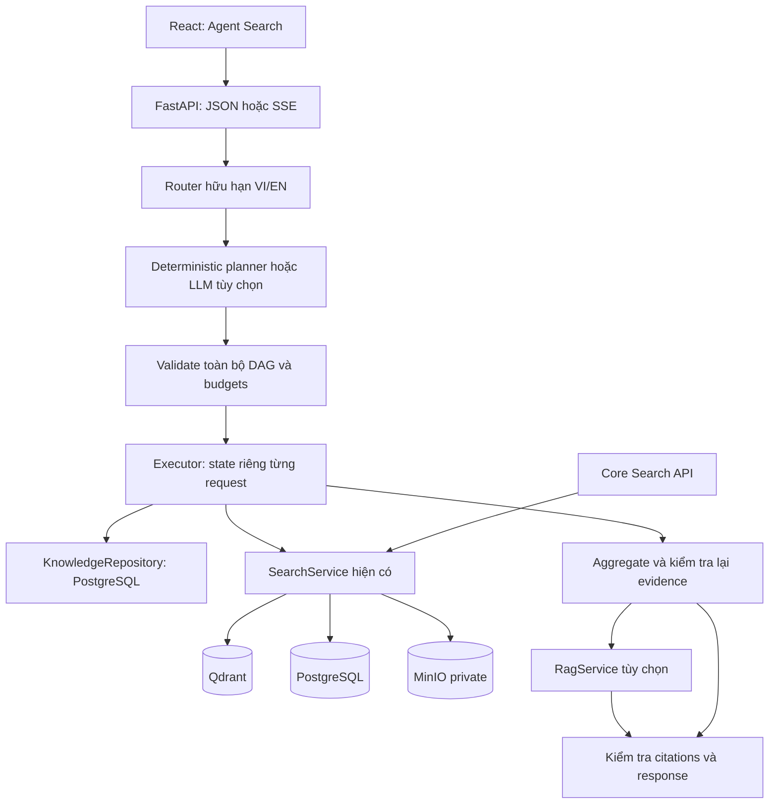

# Kiến trúc Agent — Phase 09

Ngày 06/11/2026. Agent là khả năng tùy chọn của modular monolith. Fast Search vẫn dùng trực tiếp SearchService, không cần planner hoặc LLM. Báo cáo thực thi và giới hạn nghiệm thu tại [PHASE09_TEST_REPORT](../archive/PHASE09_TEST_REPORT.md).

## Luồng và ranh giới

Router tái sử dụng query analysis Phase 06. Query đơn giản đi một tool semantic; nhiều intent đi engine Phase 06; text + stored image đi multimodal; quan hệ được nhận diện mới lập chuỗi nhiều bước. API core `auto` không tự chuyển sang Agent. Router Agent có finite grammar, không phải bộ hiểu ngôn ngữ tổng quát. Mẫu quan hệ chưa hỗ trợ trả `UNSUPPORTED_RELATIONAL_PATTERN`; qualifier chưa giải được gây warning `QUERY_INTERPRETATION_LIMITED`.

Planner deterministic không gọi provider. LLM planner dùng abstraction Gemini/OpenAI-compatible đã có ở Phase 08, yêu cầu JSON có kiểu và bị kiểm tra toàn bộ trước execution. Trong phase này planner LLM chỉ được biểu diễn lại template quan hệ đã nhận diện; không được tự mở rộng công cụ hoặc tự bổ sung sự kiện từ kiến thức model. `allow_fallback=true` cho phép trở về cùng template deterministic khi lập kế hoạch LLM thất bại. Quan hệ thiếu evidence không fallback sang tìm ảnh rộng rồi coi là đã trả lời.

## Quyết định framework

Chọn custom finite DAG executor dựa trên asyncio và Pydantic đang có trong lockfile. Các chain tối đa 6 calls, 3 logical hops, không durable checkpoint, nên chưa có lý do thêm LangGraph, broker hoặc graph database. Không thay dependency locks. Phiên bản planner `agent-template-plan-v2`; prompt digest, model thực trả về và usage do provider cung cấp được ghi trong response. Hỗ trợ DAG độc lập nhưng thực thi tuần tự để giữ thứ tự và budget rõ ràng; chưa đo lợi ích chạy song song.

## Modules và dependency

| Module dưới `backend/app/services/agent` | Trách nhiệm |
| --- | --- |
| router.py | Strategy, anchor, uncertainty; giữ query gốc đã normalize |
| planner.py | Template và structured LLM plan |
| plan_validator.py | Allowlist, typed arguments/references, DAG, semantics, budgets |
| tool_registry.py / tools.py | Contract và adapter sang dịch vụ đã có |
| tool_executor.py / multi_hop.py | Timeout, cancellation, dependencies, lặp, traces |
| state.py | Bộ nhớ trong một request |
| evidence_aggregator.py | Revalidate ảnh, entities, relations, links; dedup |
| response_builder.py / agent_service.py | Kết quả có status, điều phối và admission |

API, schemas, repositories, migration và frontend nằm ở layer hiện có. Agent không gọi shell, không chạy SQL do model sinh, không fetch URL tùy ý và không có tool ghi dữ liệu. Import tri thức là CLI quản trị riêng. Không checkpoint hoặc lưu lịch sử hội thoại cá nhân.

## Khi không có dữ liệu

Service và 9 tool definitions vẫn khởi tạo khi `SEARCH_ENABLED=false`. Planner hợp lệ vẫn được tạo; `empty_dataset` trả `insufficient_evidence`, results rỗng. Có ảnh nhưng search runtime chưa sẵn sàng trả `search_unavailable`. Kho quan hệ rỗng với corpus ảnh sẵn sàng vẫn cho phép tìm ảnh đơn giản. Không cần captions để retrieval; RAG phụ thuộc evidence thực có.

Xem [thiết kế tools](AGENT_TOOL_DESIGN.md), [multi-hop](MULTI_HOP_SEARCH.md), [state](AGENT_STATE_MANAGEMENT.md), [API](AGENT_API.md) và [knowledge](KNOWLEDGE_BASE_DESIGN.md).

## Bổ sung ở lần hoàn thiện

Planner gửi required template và argument keys đã duyệt, không lặp toàn bộ JSON schemas dài vào provider prompt; validator server vẫn kiểm tra full schema/DAG/semantics. `planner_trace` ghi duration, error/status và input bytes từng attempt, kể cả timeout đã phục hồi. Lỗi auth/config không retry. Agent RAG dùng compact context chỉ gửi fact_id/field/quote; UUID và provenance đầy đủ vẫn trên server để validate và render citations. Không đổi CLIP hoặc dependency locks. Kho NPS có dữ liệu thật, [PUBLIC_LANDMARK_DATASET](../research/PUBLIC_LANDMARK_DATASET.md); empty-dataset fixtures vẫn được kiểm tra riêng.
