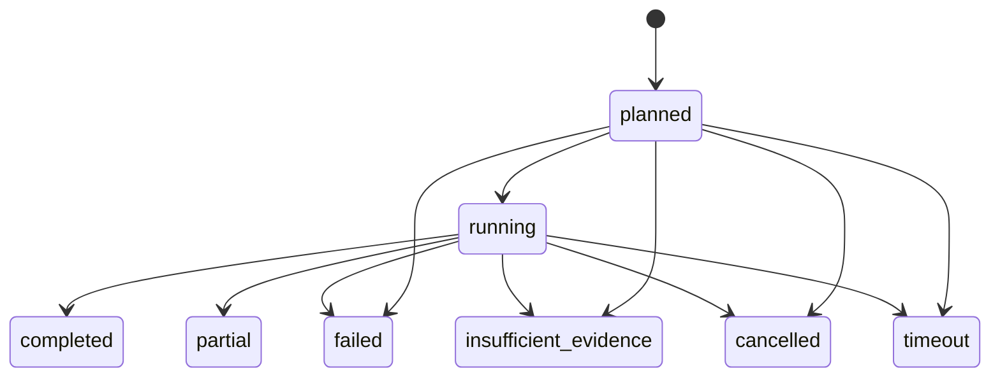

# State, budgets và phục hồi lỗi

`AgentState` là dataclass riêng từng request, gồm request/query/execution IDs, query gốc, selected route, plan, outputs theo step ID, traces theo thứ tự, fingerprints, warnings, deadline monotonic, counters và planner telemetry. Original query chỉ tồn tại trong bộ nhớ request; technical metrics không lưu raw query, prompt, headers, API key hoặc chain-of-thought.

## Chuyển trạng thái

Terminal state không được chạy lại. `completed` có ảnh đủ eligibility và không warning execution; `query_success` còn yêu cầu status completed. Đây là success cấu trúc, không phải đánh giá relevance/faithfulness. `partial` giữ ảnh đã kiểm tra khi tùy chọn RAG/provider thất bại, query có qualifier chưa giải được hoặc deadline đến sau retrieval. `insufficient_evidence` chỉ ra thiếu dữ liệu. `failed` là lỗi workflow/dependency; `timeout` là hết hạn chưa có ảnh đã xác minh. Client ngắt SSE làm child task cancelled và nhả admission, không đảm bảo nhận được terminal event qua connection đã đóng.

## Giới hạn hiện hành

| Ngân sách | Server mặc định / trần request |
| --- | --- |
| Hops | 3 / 1…3 |
| Tool calls | 6 / 1…6, bao gồm RAG |
| Replans | 1, tổng tối đa 2 planning attempts |
| Overall deadline | 15 giây; request 100…30.000 ms được clamp theo server |
| Tool timeout | 2 giây; RAG lấy timeout riêng và phần deadline còn lại |
| LLM planning timeout | 4 giây/attempt, cùng overall deadline |
| Concurrent Agent requests | 2, từ chối khi đầy |
| Planner output | Tối đa 512 tokens, JSON tối đa 32 KiB |
| Generation output | Min của request budget và RAG config |
| API body / tool output / SSE queue | 64 KiB / 256 KiB / 256 events |

Các con số là cấu hình thực thi local, không phải SLO hay giới hạn đã tối ưu. Timeout 15 giây không đồng nghĩa đạt mục tiêu TTLast 3 giây. Không thêm sleep/retry vô hạn. Tool failure dừng dependencies; optional generation failure giữ ảnh đã được aggregator kiểm tra trước generation. Aggregation ban đầu và aggregation sau answer đều nằm trong deadline.

## Bộ nhớ và quan sát

Không checkpoint durable, long-term memory hoặc session history. Shared service chỉ giữ bounded admission count và các technical sample rings; output/state không dùng chung giữa người dùng. `AGENT_LOG_TRACE=false` bỏ step traces khỏi ring; public response vẫn cần steps để người dùng biết execution thực tế. SSE không phát raw planner messages; UI chỉ hiển thị public progress và final response đã kiểm tra. Caller có read token trong single-tenant local MVP được đọc samples; chưa có tenant isolation hoặc retention cho deployment công khai.

Test bao phủ state isolation, terminal transition, timeout, cancellation, repeat calls, DAG cycles, invalid plans, bounded replanning và giữ results khi RAG hết hạn. Provider/network cancellation không được coi là bằng chứng remote compute đã dừng tức thì.

## Trace từng planning attempt

`planner_trace` tối đa2 records: attempt, running/completed/failed/timeout/cancelled, duration_ms, sanitized error_code và input_bytes. Tổng planning_ms gồm cả validation/retry. Provider-disabled có trace thất bại nhưng planner_attempts=0 vì không gọi provider. Auth/config/model-unavailable/rate-limited không retry; timeout hoặc invalid structured plan có thể replan trong budget. Không lưu raw prompt hoặc private reasoning. Metrics timeout đếm cả planner timeout đã phục hồi và transport timeout, tách khỏi terminal workflow failures. Có unit test hai request cùng chạy, request thứ ba bị từ chối và state/counters được cô lập.
