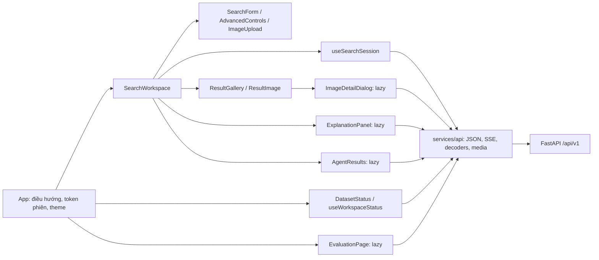

# Kiến trúc frontend — Phase 10

Ứng dụng Lens tiếp tục dùng React, TypeScript strict, Vite và Tailwind trong `frontend/`. Giữ backend modular monolith, CLIP, collection và dữ liệu của các phase trước. Không tạo ứng dụng demo hoặc môi trường triển khai công khai.

## Ranh giới module

- `app/App.tsx`: shell, navigation `/` và `/evaluation`, back/forward, trang không tồn tại, token trong memory, theme sáng/tối.
- `features/search/SearchForm.tsx`: dữ liệu nháp, validation, phương thức, Top-K, filters, fusion, rerank và đầu vào Agent. Không gọi API khi gõ truy vấn.
- `features/search/useSearchSession.ts`: server state và danh tính request; AbortController, kết quả semantic/Agent, public progress, query đã gửi và timing. Form nháp không thay đổi câu hỏi giải thích của kết quả cũ.
- `features/search/ResultGallery.tsx`: gallery dùng chung, thứ hạng backend, score type, evidence; dialog metadata riêng. `ResultImage` trì hoãn cả authenticated fetch bằng IntersectionObserver.
- `features/agent/api.ts`: contract Agent và các public event; dùng SSE transport chung. `features/rag/ExplanationPanel.tsx`: explicit explain-existing, JSON/SSE theo capabilities, không thực hiện retrieval lần nữa từ UI.
- `services/api`: client JSON tập trung, error, decoder runtime, đường dẫn media và SSE reader giới hạn dung lượng/deadline. Types ở `types/api.ts`.
- `features/system`: snapshot dataset riêng tư, trạng thái capability và hướng dẫn tiếp theo. `features/evaluation`: chỉ đọc số liệu tổng hợp thật.

## Quyết định về state và dependency

React state/hook đủ cho hai route và một workspace. Không thêm global store, React Router hay TanStack Query vì chưa có nhu cầu caching/đồng bộ phức tạp. Navigation dùng History API, xử lý popstate; chuyển route sẽ hủy workspace đang chạy. URL không chứa token hoặc ảnh upload. Không cache câu trả lời AI hay private image bằng localStorage/Service Worker.

Token đổi thì request cũ bị abort và kết quả gắn token cũ không được render. Controller identity và signal đều phải còn hợp lệ trước khi nhận response; response cũ không thể kết thúc loading của response mới. Ảnh và metadata có vòng đời request riêng, hủy khi đổi ảnh/đóng dialog/unmount. Blob URL được thu hồi khi thay đổi hoặc unmount. Preview dùng effect để đồng bộ tài nguyên URL của trình duyệt; có ghi chú ESLint cục bộ cho trường hợp này, không tắt quy tắc toàn dự án.

Chỉ theme được lưu ở `lens.theme`. Token truy cập API, Gemini key, query image và kết quả không được lưu bền trên trình duyệt. Provider key chỉ ở backend.

## Trạng thái

Search session: `IDLE → SEARCHING → SUCCESS | EMPTY | INDEX_NOT_READY | ERROR`; validation có `VALIDATING`; người dùng có thể chuyển sang `CANCELLED`. Dataset state độc lập: `empty_dataset`, `index_building`, `index_not_ready`, `ready`, `unavailable`. Không dùng số lượng kết quả của một query để kết luận dataset rỗng.

Các panel detail, Agent, RAG, evaluation được code split. Gallery tối đa 50 thẻ nên chưa cần virtualization; lazy network hạn chế số ảnh tải ban đầu. Không thay cơ chế xác thực, ingestion, ranking, provider retries hoặc active-index cutover của backend.

## Hợp đồng bổ sung nhỏ ở backend

`GET /system/workspace` và `GET /system/evaluation` là các endpoint read-only có `require_read_access`. Không migration. Image detail trả metadata nullable nếu bản ghi metadata thiếu, thay vì lỗi dereference. Xem [tích hợp API](FRONTEND_API_INTEGRATION.md), [mode dữ liệu rỗng](FRONTEND_EMPTY_DATASET_MODE.md) và [báo cáo nghiệm thu](../archive/PHASE10_TEST_REPORT.md).
