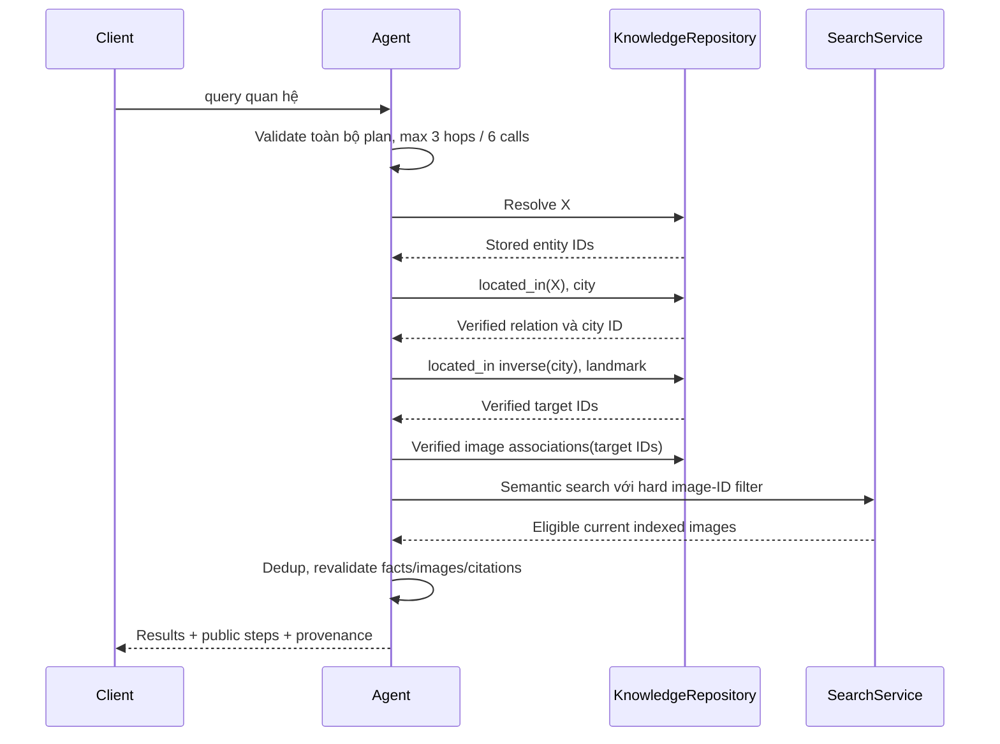

# Tìm kiếm nhiều bước có phụ thuộc

Mẫu được hỗ trợ: “Find landmarks in the city where X is located” cùng một số cách diễn đạt Anh/Việt tương đương. Anchor X được lookup trong PostgreSQL. Không dùng Gemini để đoán thành phố khi không có cạnh.

| Step | Tool | Nguồn arguments | Logical hop |
| --- | --- | --- | --- |
| anchor | entity_lookup | Tên X từ query | 0 |
| city | relationship_lookup | anchor.entity_ids, located_in, out, city | 1 |
| targets | get_related_entities | city.entity_ids, located_in, in, landmark | 2 |
| images | semantic_image_search | targets.entity_ids, query landmark, filters của request | 3 |

Có 4 tool calls và 3 logical hops. Entity lookup ban đầu là bước neo, không tính là traversal; rerank/RAG hop cost 0 nhưng vẫn tốn calls và thời gian. `depends_on` và typed references thể hiện việc output trước trở thành input sau, khác các truy vấn multi-intent độc lập Phase 06.

## Điểm dừng

Không entity → dừng sau 1 call; thiếu city relation → dừng sau 2; không landmark/verified image association → insufficient evidence. Hai cạnh `located_in` đến hai city khác nhau được xem là xung đột, không tự chọn theo score. Alias trùng nhiều entity cũng không tự chọn. Evidence vắng không có nghĩa phát biểu phủ định về thế giới thực.

Validator phát hiện cycle trong DAG, ref sai kiểu và vượt hop/call budget trước execution. Executor phát hiện call lặp, traversal quay lại entities đã thăm, unresolved/no-progress output; deadline và tối đa một replan chặn vòng lặp. Template LLM bị kiểm tra semantics để không đổi anchor, filters hoặc bỏ chuỗi quan hệ bắt buộc.

## Bằng chứng kiểm thử

Fixture dùng các tên hư cấu `Fixture Lake Alpha`, `Fixture City Beta`, `Fixture Landmark Gamma`. Ảnh coffee có thật chỉ được gắn vào fixture để kiểm tra đường đi IDs, không chứng minh ảnh chụp địa danh. Test dùng DB `agent_test_<uuid>`, bucket/collection riêng, tự dọn. Mẫu Hồ Hoàn Kiếm trên serving DB trống trả thiếu evidence; chưa chứng minh truy hồi địa danh thực tế. [AGENT_EVALUATION](../research/AGENT_EVALUATION.md) phân biệt workflow correctness và semantic accuracy.

## Workflow thật với bộ NPS

`Find landmarks in the city where Washington Monument is located` resolve Washington Monument → Washington, D.C. → ba địa danh NPS → ba ảnh có verified associations. Có4 calls/3 hops, kết quả VERIFIED_WITH_REAL_DATA về execution và được đối chiếu với source/import receipts. Query tiếng Việt và alias `Jefferson Memorial` cũng đã chạy. Có source URLs cho từng cạnh, mở được tại UI “Nguồn quan hệ”. [Nguồn, quyền ảnh và giới hạn quality](../research/PUBLIC_LANDMARK_DATASET.md). Hồ Hoàn Kiếm chưa có trong kho; không suy ra facts Hà Nội từ bộ NPS.
