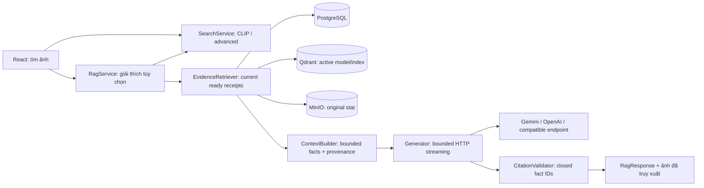
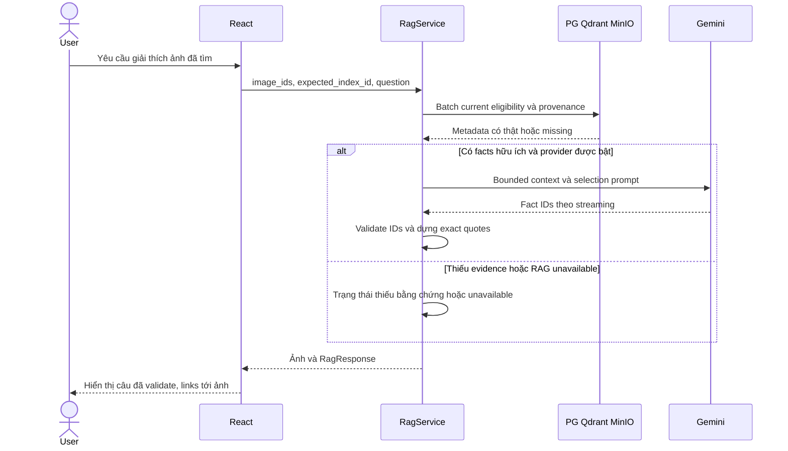

# Kiến trúc RAG tùy chọn — Prompt08

Cập nhật06/11/2026: đã có corpus510 ảnh/500 captions; phần mềm đạt152 backend tests,13 frontend unit và16 browser cases. Human quality review chờ xác nhận theo lựa chọn của người dùng. [Báo cáo hiện hành](../archive/PHASE08_COMPLETION_REPORT.md); các số liệu05/11 bên dưới là lịch sử. Không tự chuyển Prompt09.

React tìm kiếm bình thường → SearchService hiện hành → PostgreSQL/Qdrant/MinIO → kết quả ảnh. Người dùng chủ động yêu cầu giải thích; không có LLM call trong Fast Search.

RAG chạy trong cùng modular monolith: RagService → SearchService hoặc danh sách IDs đã truy xuất → EvidenceRetriever → ContextBuilder → Generator → ChatProvider → CitationValidator → RagResponse. Không thêm vector engine, queue, microservice, agent hoặc multi-hop. Với Explain Existing, client chỉ gửi IDs/index/question; mọi metadata được đọc lại từ kho, không nhận caption/score do client cung cấp.

## Sơ đồ thành phần

Core/model/index/generation giữ nguyên. Generator khởi tạo connection pool riêng ở lifespan, không tải local LLM. Config/provider lỗi làm RAG unavailable; search vẫn chạy. Remote model không nhận ảnh nhị phân, credentials của data services, storage keys hoặc lịch sử người dùng. [Triển khai](RAG_IMPLEMENTATION.md), [API](RAG_API.md), [prompt](RAG_PROMPT_DESIGN.md), [nghiệm thu](../archive/PHASE08_TEST_REPORT.md).

## Sequence giải thích kết quả

